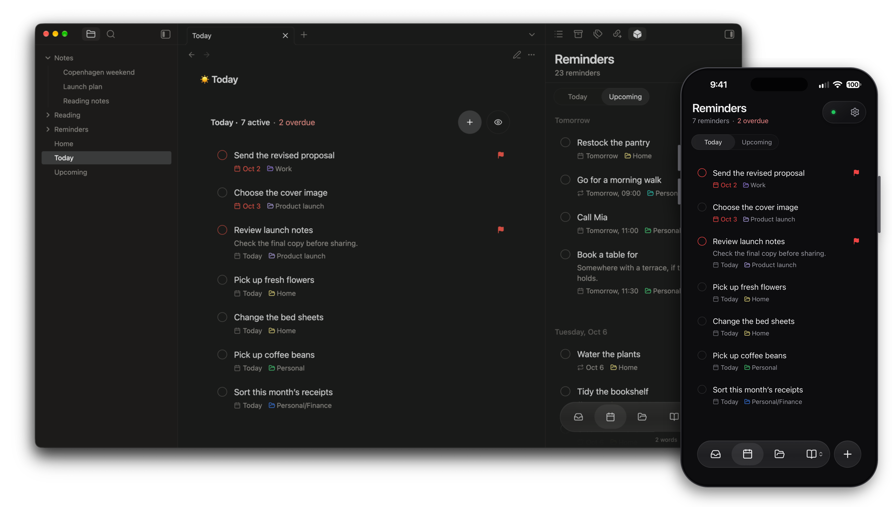

# Crate

Self-hosted Obsidian vault sync and reminders using Cloudflare R2, Workers, D1, and push notifications.



Crate is an Obsidian plugin for people who want to own the infrastructure behind their vault sync. Deploy into your own Cloudflare account, or run the same Worker on your own computer with Miniflare and persistent local storage. Crate is not a hosted service and does not require a Crate account.

## Status

Crate is early self-hosted software. Review the code, understand the Cloudflare resources it creates, and test with a non-critical vault before using it for important notes. It is not yet in the Obsidian community plugin catalog; install it from source or from release artifacts.

## Features

- **Vault sync** across desktop and mobile, with attachments, deletes and renames, 30-day file history, and conflict copies instead of silent overwrites
- **Your infrastructure:** file contents in your R2 bucket, metadata in your D1 database, deployed through Cloudflare sign-in without giving the plugin an account API token
- **Local hosting:** run the same server on your own computer or in Docker, with no Cloudflare account required
- **Reminders** stored as Markdown in your vault, with `reminders`, `reminders-today` and `reminders-upcoming` query blocks and push notifications through your own Worker
- **Reading** list for saved links, articles and YouTube transcripts, with highlights stored as ordinary Markdown
- **Web app** for reminders and Reading on your phone, installable to the Home Screen and usable without Obsidian open
- **Optional end-to-end encryption** for notes, attachments, history and reminder text

## Documentation

Start with the [documentation site](https://crate.kaanbiryol.com/docs/): [install the plugin](https://crate.kaanbiryol.com/docs/getting-started/installation/), [choose your hosting](https://crate.kaanbiryol.com/docs/getting-started/hosting/), then [connect your devices](https://crate.kaanbiryol.com/docs/getting-started/devices/). Feature guides cover [vault sync](https://crate.kaanbiryol.com/docs/features/sync/), [reminders](https://crate.kaanbiryol.com/docs/features/reminders/), [Reading](https://crate.kaanbiryol.com/docs/features/reading/), the [web app](https://crate.kaanbiryol.com/docs/features/web-app/), [encryption](https://crate.kaanbiryol.com/docs/features/encryption/) and [practical limits](https://crate.kaanbiryol.com/docs/getting-started/limits/).

For operators and contributors:

- [Deploying and operating the server](docs/deployment.md), including R2 activation and billing, updates, and [deleting a server](docs/deployment.md#delete-a-crate-server)
- [Run on your own computer or in Docker](docs/self-hosting.md)
- [Architecture](docs/architecture.md), [sync pipeline](docs/sync-pipeline.md), [Worker API](docs/worker-api.md), [testing](docs/testing.md)
- [Contributing](CONTRIBUTING.md) and [release preparation](docs/releases.md)

## Install from source

Requires Obsidian 1.13.0 or newer, and either a Cloudflare account with R2 enabled or a computer to run the [local server](docs/self-hosting.md). Building needs Node.js and npm; see `.nvmrc` and `package.json` for the supported version.

```bash
git clone https://github.com/kaanbiryol/obsidian-crate.git
cd obsidian-crate
npm install
npm run build
```

Copy `dist/main.js`, `manifest.json` and `dist/styles.css` into `<Vault>/.obsidian/plugins/crate/`, reload Obsidian, and enable **Crate** in **Settings → Community plugins**. Then open **Settings → Crate** and select **Connect with Cloudflare** (activate R2 first; see [R2 activation and billing](docs/deployment.md#activate-r2-before-connecting)), or connect to a [local server](docs/self-hosting.md).

Automatic sync is off by default on each device. After connecting, run **Crate: Sync now** for your first sync. Reading and Reminders stay off in a vault until you turn them on in **Settings → Crate**, which names the folder each one will change.

## Accounts, costs and network use

- **Accounts and payment:** Crate has no account or payment of its own. Hosting on Cloudflare needs a Cloudflare account with R2 activated; Cloudflare asks for a payment method during R2 checkout even if you stay within the free allowance, and bills any usage beyond it to you. Local hosting on your own computer needs neither.
- **Your Crate server:** sync, reminders and the web app connect to the server you deploy or run (your Cloudflare Worker or your local server).
- **Cloudflare:** connecting, updating, deleting a server and showing its usage call Cloudflare's API after you sign in. The sign-in returns through `https://crate.kaanbiryol.com/oauth/callback/`, a static page that hands the authorization code back to Obsidian and stores nothing.
- **Websites you save or paste:** Reading downloads each saved link from its original site, directly from Obsidian or through your server for the web app and iPhone shortcut. For X, Reddit, Bilibili and C2 wiki links it may also call a fixed list of public APIs. Pasting a link into a reminder fetches its page title through your server.
- **YouTube:** saved YouTube links show thumbnails from `i.ytimg.com` and play in YouTube's privacy-enhanced `youtube-nocookie.com` player.
- **Push service:** only when you turn on notifications, your server sends encrypted payloads through your browser's or device's push service.

## Privacy and security

- Vault files go to your own server and storage. Crate has no hidden telemetry, fetches no remote code at runtime, and needs no Crate account.
- Secrets and Cloudflare credentials are kept in Obsidian's secret storage.
- Reading downloads saved links from the original site. Obsidian downloads on your device; the web app asks your server, which doesn't store the link when encryption is on. For X, Reddit, Bilibili and C2 wiki links it may also call a fixed list of public APIs, including the third-party FxTwitter API, with the saved link only.
- Push notifications are optional. Payloads are encrypted, and the push provider sees only delivery metadata.
- Optional [end-to-end encryption](docs/e2ee-implementation.md) hides note content from the server operator. Without it, the operator can read synced content.
- Sync is not a backup. Keep an independent backup of any vault you use with Crate.
- Remote deletions move local files to the vault's `.trash` folder.

See [privacy and data handling](docs/privacy.md) for the full data-flow details and the [privacy policy](https://crate.kaanbiryol.com/privacy/). Report vulnerabilities privately through [SECURITY.md](SECURITY.md).

## License

Crate is licensed under the [MIT license](LICENSE). Licenses for bundled dependencies are listed in [THIRD_PARTY_NOTICES.md](THIRD_PARTY_NOTICES.md).
