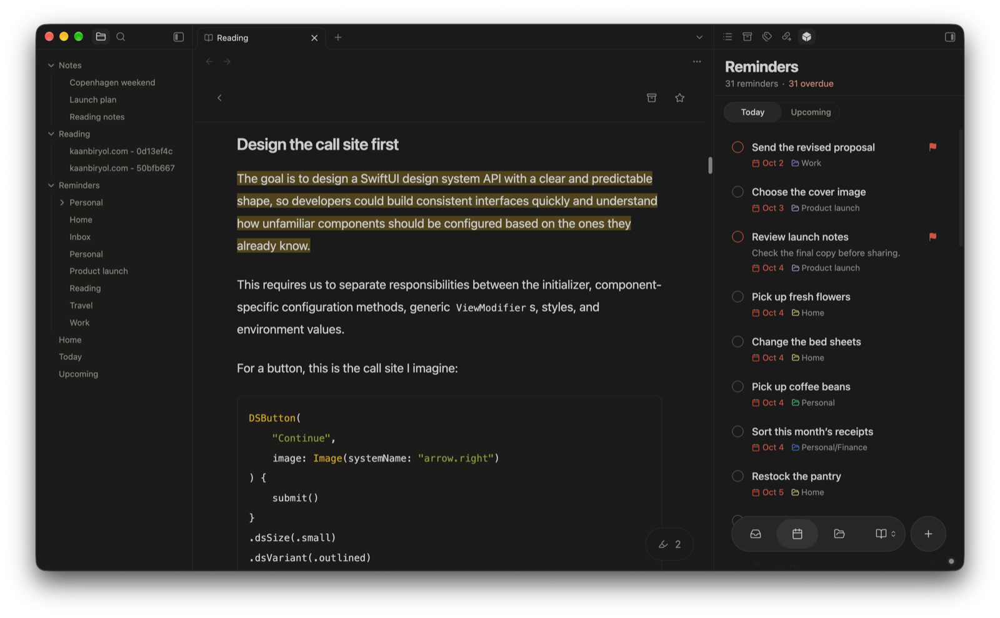
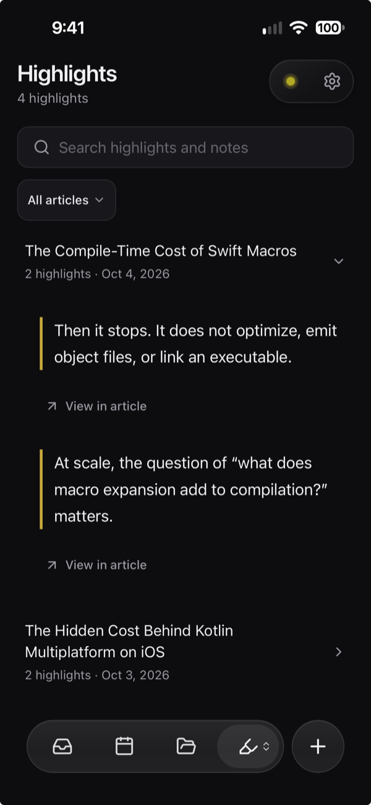

Save articles to read later, and keep their full text in your Obsidian vault as ordinary notes. Highlight what matters, read offline, and pick up on your phone where you left off.

## Save your first article

1. Open **Settings → Crate → Reading** and turn on **Enable reading**. Crate adds reading properties to every Markdown note in your Reading folder, so it names the folder and asks first. To use another folder, change **Reading folder** before turning Reading on.
2. Run **Crate: Add link to reading list** and paste an article link.
3. Run **Crate: Open reading library** to find it in your inbox.

Articles go into your Reading folder, `Reading` unless you choose another, and this works without a server.

Crate saves the link right away, then downloads the article on this device. If the download fails, the link stays saved and the reader offers **Try again**.

How notes are named

New notes are named after the article and its site, such as `The Hidden Cost - example.com - a1b2c3d4.md`. Until the title is known, the name uses the site alone. Once the title arrives, Crate renames the note to include it, unless you've renamed it yourself. Existing notes keep their names.

## Where articles are downloaded

The save form tells you which device does the downloading:

| Where you save | What happens |
| --- | --- |
| Obsidian | This device downloads the article and writes a Markdown note. Vault sync carries it to your other devices. |
| Web app without encryption | Your Crate server downloads it, so Obsidian can stay closed. |
| Web app with encryption | Your Crate server downloads it without keeping the link, and the web app encrypts it. If the website blocks the server, the link is saved with **Try again**. |

### When a page won't download

Pages behind a login, pages that block downloads, and pages that rely on scripts may stay as saved links. Server downloads don't use your browser cookies or Crate sign-in. Select **Try again**, open the original page, or use [Web Clipper](#use-obsidian-web-clipper) to save what you can see in your browser.

With [end-to-end encryption](/docs/features/encryption/), article text, links, tags, highlights, and note names stay encrypted on the server.

## Organize your library

- **Inbox** is for what you haven't read yet.
- **Favorites** are pieces you want to come back to.
- **Archive** is for finished reading. Archived articles stay in your library.

Search your library or filter by tag. To tag an article, select **Tags** while reading it.

Articles are regular Markdown notes, so they sync like the rest of your vault. Changing the Reading folder doesn't move existing notes.

## Use Obsidian Web Clipper

Already use Web Clipper? Point it at your Reading folder in the right vault. No special template is needed.

Every Markdown note in that folder and its subfolders shows up in Reading. Crate keeps the clip's text and file name, picks up its tags, and doesn't download the article again. Notes without a source link show up as vault notes.

Duplicates and empty bookmarks

If you clipped the same page more than once, **Review duplicate sources** lets you compare the copies. In Obsidian, **Fill empty bookmark** copies a clip into a saved link that never downloaded. The bookmark keeps its identity, and the original clip is kept for you to review.

## Save YouTube videos and transcripts

Save a YouTube link the same way as an article. Crate saves the video's public details and, when captions are available, its transcript. Without captions, the video is still a working bookmark.

To watch, select the play icon, tap a transcript passage, or select transcript text. The player starts from that point. If it can't play inside Crate, select **Open in YouTube**. Crate never downloads the video itself.

You can highlight transcript passages and add notes, and saved transcripts stay readable offline. Transcripts without timestamps work too.

Pin and resize the video

**Pin video** keeps the video above the transcript and follows along as it plays, including when you skip around. Scrolling holds still while you select text or edit a highlight. **Unpin video** lets you scroll freely. Drag the handle below the video to resize it, up to the full reader width. Pinning a very large video shrinks it to leave room for the transcript.

Save transcripts with Web Clipper

Web Clipper can save a transcript into your Reading folder too. Check its preview first: a note with only a video embed doesn't include the transcript. The repository has an optional [Reading Clipper template](https://github.com/kaanbiryol/obsidian-crate/blob/master/templates/crate-reading-clipper.json) for saving the full content.

## Highlight and revisit passages

Select text while reading to highlight it. Tap or select a highlight to copy, share, delete, or resize it. Each article's **Highlights** view shows your notes alongside a **View in article** action.

The library's **Highlights** view collects highlights from your inbox, favorites, and archive in one place. Search them, or filter by article or tag.

Highlights are saved in the note, so they sync with it. Most use Obsidian's own `==highlight==` syntax. Selections that can't safely use those markers are stored as annotations that Crate's reader displays. See the [highlight format reference](https://github.com/kaanbiryol/obsidian-crate/blob/master/docs/reading-highlights.md) for details.

## Read on your phone

[Connect the web app](/docs/getting-started/devices/#open-the-web-app) to use the same library outside Obsidian. You can paste a link straight into the library.

### Save from the share sheet on iPhone

With iOS 27 or later, open **Reading settings → Set up iPhone shortcut** and follow the steps to install and pair **Save to Crate**. After that, select **Share → Save to Crate** from any app. The shortcut needs a connection.

Pairing codes work once and expire after ten minutes. You can also get the shortcut from [Crate’s iPhone shortcut page](/shortcuts/v1/): select **Download shortcut**, then **Add Shortcut**, and return to Reading settings to create a pairing code. If the page says the shortcut isn't available yet, use **Reading → Save a link** until it is.

The shortcut works with encryption too: your server downloads the article and saves it locked to your vault, and your devices open it. Sharing the same link twice saves it twice.

### Save from the share sheet on Android

In browsers that support sharing to web apps, install the web app, then select **Share → Crate**. It works with encrypted vaults too.

## Read offline

In Obsidian, article text lives in your vault, so it's always available offline.

The web app keeps up to 200 articles or 50 MB of article text. Articles you open are kept first. While the app is open and online, it also saves a few of your newest inbox articles each time it refreshes, so you can read them offline without opening them first. Archived articles are saved only when you open them, and Data Saver turns background saving off.

Saves and edits you make offline stay pending until your server confirms them. Export pending work before clearing browser data or signing out. If something gets stuck, see [Recovery](/docs/troubleshooting/recovery/#pending-work-in-the-web-app).

## Privacy and availability

Crate's reader blocks remote images and active content inside articles, so the article text itself doesn't load anything from the web. A few things do reach out:

- **Favicons and thumbnails:** library icons can contact the saved site or its icon host, and YouTube thumbnails contact YouTube's image host. Those hosts see the request and may receive their own cookies. Crate doesn't send your Crate sign-in or the page you came from.
- **The YouTube player:** it loads only when you select the play icon or a timed transcript passage. It contacts YouTube, may use YouTube's cookies, and may see the web app's address as the referring page. It never receives your Crate sign-in or note contents.
- **Article downloads on the server:** these use your hosting resources.

Reading notes can be up to 1 MB, even though larger files can still sync as ordinary vault files.

Services contacted for some sites

When a page is only a login screen or needs more data, links from X, Reddit, Bilibili, and C2 wiki may also contact a fixed list of public services: X's embed service and the third-party FxTwitter service for X posts, Reddit's own pages and feeds, and the Bilibili and C2 wiki services. These requests send the saved link, not your cookies or Crate sign-in. The service also sees the IP address of the device or server doing the download, and on Cloudflare, server requests include your Crate server's web address.

## Pause or resume Reading

Under **Settings → Crate → Reading**, turn off **Enable reading** to pause scanning and downloads on all connected devices. Turn it back on to resume. Your library, notes, connections, and vault sync are all kept. Changing this shared switch needs a connection.

There's no separate switch just for downloads. See [Choose and manage features](/docs/features/settings/) for the other controls and what they affect.
