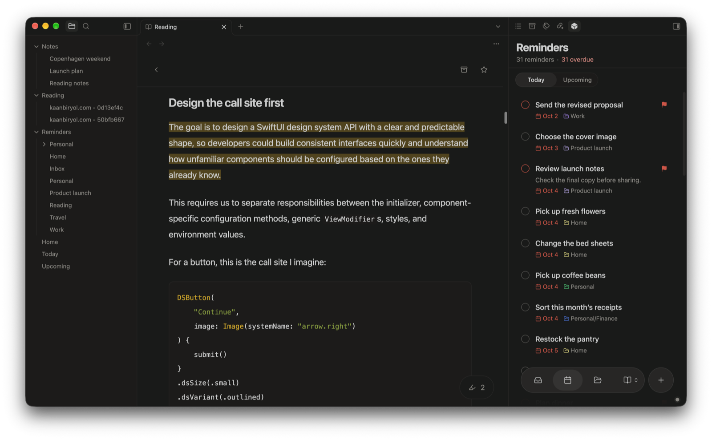
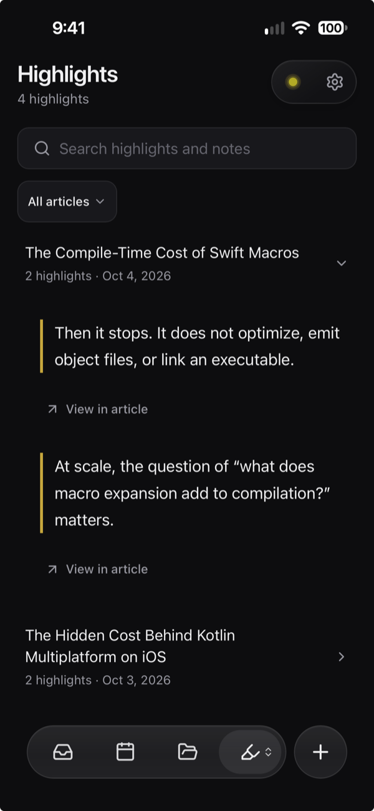

Save articles to read later, and keep their full text in your Obsidian vault as ordinary notes. Highlight what matters, read offline, and pick up on your phone where you left off.

## Save your first article

1. Open **Settings → Crate → Reading** and turn on **Enable reading**. Crate adds reading properties to every Markdown note in your Reading folder, so it names the folder and asks first. To use another folder, change **Reading folder** before turning Reading on.
2. Run **Crate: Add link to reading list** and paste an article link.
3. Run **Crate: Open reading library** to find it in your inbox.

Articles go into your Reading folder, `Reading` unless you choose another, and this works without a server.

Crate saves the link right away, then downloads the article on this device. If the download fails, the link stays saved and the reader offers **Try again**.

How notes are named

New notes are named after the article and its site, such as `The Hidden Cost - example.com - a1b2c3d4.md`. Until the title is known, the name uses the site alone. Once the title arrives, Crate renames the note to include it, unless you've renamed it yourself. Existing notes keep their names.

## Where articles are downloaded

Saving in Obsidian downloads the article on that device, and vault sync carries it to your others. Saving in the web app has your Crate server download it, so Obsidian can stay closed. The save form tells you which one happens.

### Article images

By default, Crate saves an article's images in your vault when it downloads the article. They go in an `attachments` folder inside the Reading folder, one folder per article, and sync like any other file. Images work offline in Obsidian, and in the web app in articles you save for offline. Deleting an article deletes its images too: the web app deletes them on the server, and Obsidian moves them to the trash you chose in **Settings** → **Files and links** → **Deleted files**.

To keep only the images' links, go to **Settings** → **Crate** → **Reading** and set **Article images** to **Load from the website**. The choice applies to every device and to articles saved from then on. The websites hosting the images then see your IP address each time you open the article, and the images need a connection.

An image that is too large, in an unsupported format such as SVG, or fails to download keeps its link. [Reading images](/docs/getting-started/limits/#reading-images) lists the sizes and formats.

### When a page won't download

Pages behind a login, pages that block downloads, and pages that rely on scripts may stay as saved links. Server downloads don't use your browser cookies or Crate sign-in. Select **Try again**, open the original page, or use [Web Clipper](#use-obsidian-web-clipper) to save what you can see in your browser.

## Organize your library

- **Inbox** is for what you haven't read yet.
- **Favorites** are pieces you want to come back to.
- **Archive** is for finished reading. Archived articles stay in your library.

Search your library or filter by tag. To tag an article, select **Tags** while reading it.

Articles are regular Markdown notes, so they sync like the rest of your vault. Changing the Reading folder doesn't move existing notes.

## Use Obsidian Web Clipper

Already use Web Clipper? Point it at your Reading folder in the right vault. No special template is needed.

Every Markdown note in that folder and its subfolders shows up in Reading. Crate keeps the clip's text and file name, picks up its tags, and doesn't download the article again. Notes without a source link show up as vault notes.

Highlights you made in Web Clipper show up in Reading when they're saved in the note as `==text==`. To also keep each highlight's date and notes, or to save YouTube transcripts, use the optional [Reading Clipper template](https://github.com/kaanbiryol/obsidian-crate/blob/master/templates/crate-reading-clipper.json). If a highlighted passage appears more than once or can't be found, it goes to the article's **Highlights** list for you to review.

Duplicates and empty bookmarks

If you clipped the same page more than once, **Review duplicate sources** lets you compare the copies. In Obsidian, **Fill empty bookmark** copies a clip into a saved link that never downloaded. The bookmark keeps its identity, and the original clip is kept for you to review.

## Save YouTube videos and transcripts

Save a YouTube link the same way as an article. Crate saves the video's public details and, when captions are available, its transcript. Without captions, the video is still a working bookmark.

To watch, select the play icon, tap a transcript passage, or select transcript text. The player starts from that point. If it can't play inside Crate, select **Open in YouTube**. Crate never downloads the video itself.

You can highlight transcript passages and add notes, and saved transcripts stay readable offline. **Pin video** keeps the video above the transcript, which follows along as it plays.

## Highlight and revisit passages

Select text while reading to highlight it. Tap or select a highlight to copy, share, delete, or resize it. To highlight an image, tap it and select **Highlight**; tap it again to add a note or delete the highlight. Each article's **Highlights** view shows your notes alongside a **View in article** action, with highlighted images as thumbnails.

The library's **Highlights** view collects highlights from your inbox, favorites, and archive in one place. Search them, or filter by tag.

Highlights are saved in the note, so they sync with it. Most use Obsidian's own `==highlight==` syntax, so they show in Obsidian too. Image highlights and a few text selections show only in Crate's reader. The [highlights reference](/docs/reference/reading-highlights/) explains the format.

## Read on your phone

[Connect the web app](/docs/features/web-app/) to use the same library outside Obsidian. You can paste a link straight into the library, or [save from your phone's share sheet](/docs/features/web-app/#save-links-from-other-apps).

## Read offline

In Obsidian, article text and saved images live in your vault, so they're always available offline.

The web app keeps an article on your device only when you ask: open it and select **More** → **Save for offline**. Select it again (**More** → **Remove offline copy**) to delete the copy. Your browser's storage is the only limit; if it runs out, remove a copy to save another. A saved article is checked for changes when you open it, never in the background. Offline copies keep the article's saved images too; images loaded from the website need a connection.

Saves and edits you make offline stay pending until your server confirms them. Export pending work before clearing browser data or signing out. If something gets stuck, see [Recovery](/docs/troubleshooting/recovery/#pending-work-in-the-web-app).

## Privacy and availability

Crate's reader blocks active content inside articles. It shows images saved in your vault, and loads images from the web only when **Article images** is set to **Load from the website**. A few things do reach out:

- **Favicons and thumbnails:** library icons can contact the saved site or its icon host, and YouTube thumbnails contact YouTube's image host. Those hosts see the request and may receive their own cookies. Crate doesn't send your Crate sign-in or the page you came from.
- **The YouTube player:** it loads only when you select the play icon or a timed transcript passage. It contacts YouTube, may use YouTube's cookies, and may see the web app's address as the referring page. It never receives your Crate sign-in or note contents.
- **Article downloads on the server:** these use your hosting resources.

For some sites, such as X and Reddit, Crate may also ask a public service for the article, sending only the saved link. Code snippets embedded from GitHub Gist are downloaded from GitHub and saved as code blocks; an article saves up to 16, and later ones stay links. The [README](https://github.com/kaanbiryol/obsidian-crate#accounts-costs-and-network-use) lists every service Crate contacts.

## Pause or resume Reading

Turn off **Settings → Crate → Reading → Enable reading** to pause scanning and downloads on every device, and turn it back on to resume. Your library and notes are kept. There's no separate switch just for downloads. [Pause Reading or Reminders](/docs/features/settings/#pause-reading-or-reminders) explains what pausing affects.
