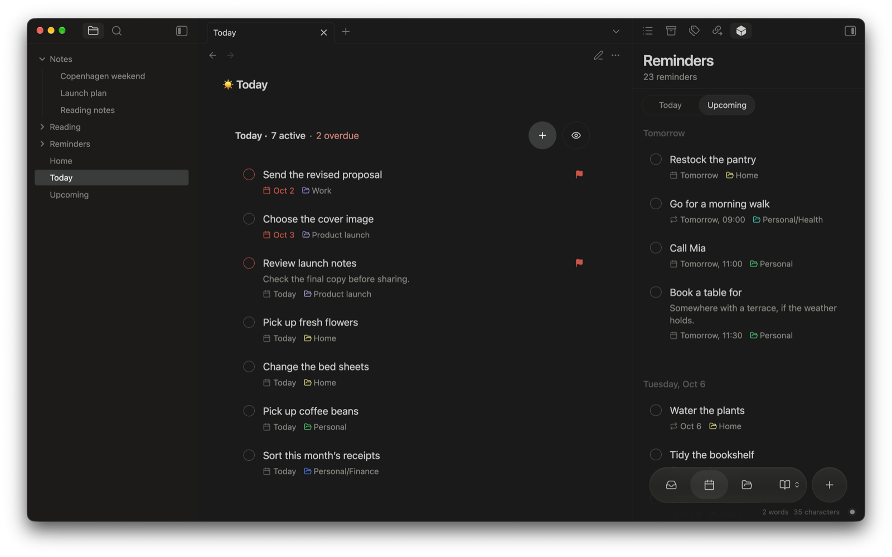
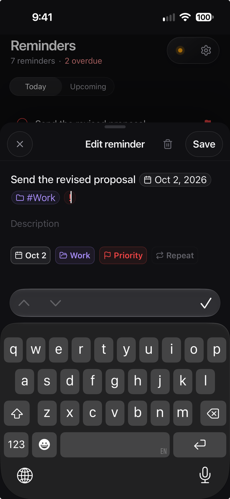
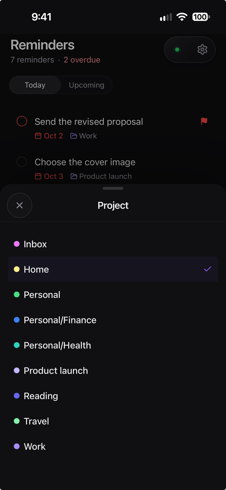
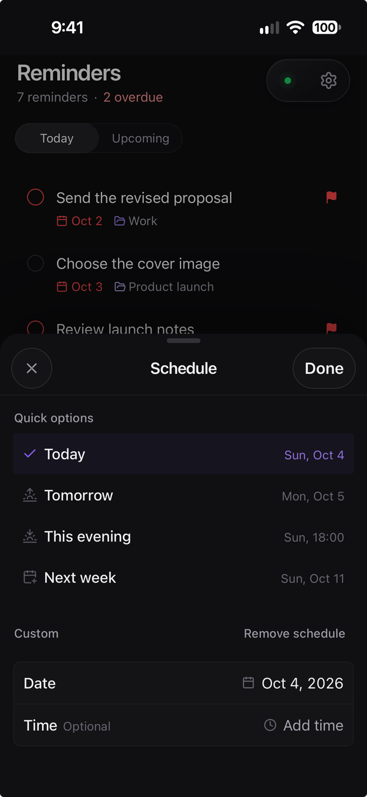

Crate reminders are ordinary Markdown checkboxes in your vault. Plan your day in Obsidian or on your phone, and your tasks stay plain text you can read and edit anywhere.



## Create a reminder

1. Open Obsidian's command palette and run **Crate: Create reminder**.
2. Type something natural, like "Send the proposal tomorrow at 12", and check the date Crate picked up. You can also set the date yourself, choose a project, add a description, set a priority, or make it repeat.
3. Save it, then run **Crate: Open sidebar** to see your reminders.

Reminders are saved in the `Reminders` folder and work without a server. You need a server for syncing and notifications. Once connected, you can pick another folder under **Settings → Crate → Reminders → Reminders folder**.

Words like "tomorrow" become a real date when you save, so the reminder doesn't keep drifting forward each time you open it.

## Organize your day

- **Inbox** holds reminders to sort out later.
- **Today** shows what's due today, plus anything overdue.
- **Upcoming** helps you plan what's next.
- **Projects** groups reminders by the work or part of life they belong to. Run **Crate: Open reminder project** to jump to one in Obsidian.

Select a reminder to edit it, or its checkbox to complete it.

Completing a repeating reminder moves the same task to its next date. After the last occurrence it stays checked. Past occurrences don't become separate tasks.

## Add links to reminders

Paste a web address into a reminder's title or description to keep an article or reference with the task, then open it straight from the reminder.

When it can, Crate uses the page's title as the link text. If you paste over selected text, your text stays as the label. Pages that are offline, blocked, slow, or untitled keep the plain address.

<details>
<summary>How page titles are fetched</summary>

Your Crate server fetches the title by contacting the website, without your cookies or sign-in details. This also works with [end-to-end encryption](/docs/features/encryption/): the server sees the link only while fetching the title and doesn't keep it.

</details>

## Work directly in Markdown

Each note in your reminders folder is a project. `Reminders/Travel.md`, for example, is the **Travel** project. Add checkboxes to it like you normally would:

```markdown
- [ ] Check passport expiry
- [ ] Book train tickets
- [x] Choose travel dates
```

Crate adds small hidden comments to each checkbox line so it can recognize the same reminder after edits and sync. Leave those comments in place when you edit existing tasks.

Crate picks up every checkbox in the reminders folder. Use a dedicated folder so checkboxes in your other notes don't become reminders.

<details>
<summary>Good to know</summary>

- Checkboxes inside code blocks are ignored.
- For nested tasks or tasks with paragraphs under them, reorder, move, or delete them in the Markdown editor so children move with their parent. The reminder list limits these edits to protect the note.

</details>

## Keep tasks beside your notes

An [embedded reminder block](/docs/features/embedded-reminders/) shows a project, today's reminders, or upcoming work inside any note. It's a live view of the same reminders, not a copy.

## Use reminders on your phone

Connect the [Crate web app](/docs/features/web-app/) to see and edit reminders without Obsidian. Changes you make there reach your vault the next time Obsidian syncs.

Select a reminder to change its title, date, project, or priority. Pick a project from the list, or choose a quick date or exact time.

  

## Get alerts

1. In Obsidian, turn on **Settings → Crate → Notifications → Push notifications**.
2. Register each device that should receive alerts in the web app.
3. For reminders with a date but no time, set an **All-day notification time**.

[Set up notifications](/docs/features/notifications/) walks through each step and a test.

## Change defaults

Under **Settings → Crate → Reminders**, choose a **Default due date**, **Default reminders tab**, and **Upcoming range (days)**. Turn on **Open reminders on startup** to have the view ready when Obsidian opens. These apply to this Obsidian device only.

Changing **Reminders folder** changes where Crate looks, not where your notes are. Read [Choose your folders](/docs/features/settings/#choose-your-folders) before switching an established setup.

## Offline and pausing

Your reminders are always available in Obsidian. The web app shows cached reminders offline, but you need a connection to make new changes there. If you submitted a change that hasn't been confirmed yet, keep it pending until the server responds.

To pause Reminders everywhere, turn off **Enable reminders** in Crate settings. This stops reminder processing and notifications on all connected devices, but keeps your notes, connections, and vault sync.

:::note[Keep reminder notes small for the web app]
The web app handles reminder notes up to 1 MB. If a note is reported as too large or unavailable, split it into smaller project notes and sync again. See [practical limits](/docs/getting-started/limits/) and [recovery](/docs/troubleshooting/recovery/) for more help.
:::
