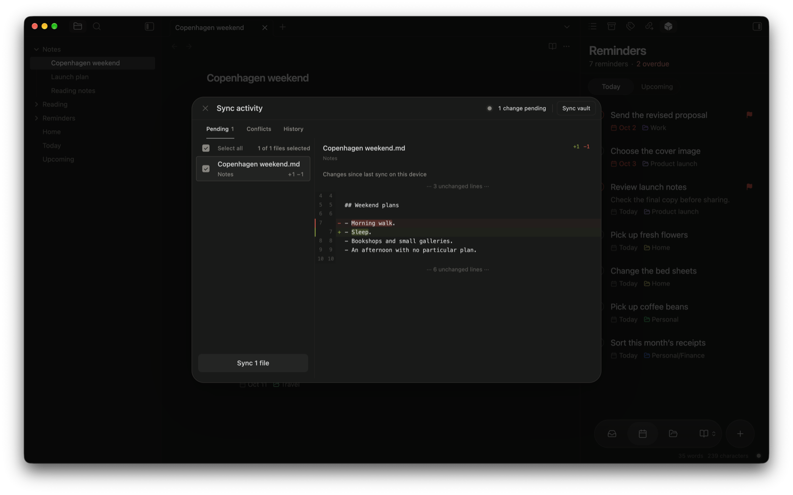

Crate keeps the same vault on all your Obsidian devices, through a server you own. Your notes stay ordinary files on each device, so you can stop using Crate at any time and keep everything.

## Your first sync

Connecting a server does not move any files yet. When you're ready:

1. Open Obsidian's command palette and run **Crate: Sync now**.
2. Wait for it to finish. On a phone, keep Obsidian open until it does.

That's it. From now on you can sync by hand whenever you like, or let Crate do it for you.

## Sync automatically

Turn on **Settings → Crate → Sync → Automatic sync**. Crate then syncs a few seconds after you edit, when Obsidian starts or comes back to the foreground, and when it notices changes from your other devices.

Automatic sync is a per-device setting, so turn it on for each device where you want it.

:::note[Keep Obsidian open on mobile]
Phones pause apps in the background, and sync pauses with them. Before switching devices, let sync finish on the first one.
:::

<details>
<summary>Fine-tune timing</summary>

Under **Sync → Sync options**:

| Setting | What it does |
| --- | --- |
| **Sync delay after editing (seconds)** | How long Crate waits after you stop typing. The default is 5 seconds; 0 syncs right away. |
| **Check for remote changes** | How often this device looks for edits from your other devices. The default is every 5 minutes. **Off** stops these checks, but edits, startup, and resume still sync. |

</details>

## Take a break from syncing

- **Sync only when you ask:** turn off **Automatic sync**. A sync that is already running still finishes.
- **Stop right now:** select **Pause sync** in Sync activity, or run **Crate: Stop sync**. This also turns off automatic sync on this device until you turn it back on.

The web app and reminder notifications keep working either way, because they use your server directly.

## See what's about to sync

Run **Crate: Show sync activity** and open **Pending** to see every file waiting to sync. Select a file to see what you changed since this device last synced it.



- Select **Sync vault** at the top to send everything, including unchecked files.
- Uncheck the files you want to hold back, then select the **Sync files** button at the bottom. It shows how many files it will send, and the rest stay pending for next time.

Holding files back applies to that one sync. If you want to decide exactly when the rest go, turn off automatic sync first.

<details>
<summary>Good to know</summary>

- The comparison shows your local edits only, not newer edits from another device.
- If you undo an edit, the file can stay in the list, labeled **Unchanged**, until the next sync.
- Images, PDFs, and very large files show a size summary instead of a text comparison.
- Select several rows with Shift-click or Cmd/Ctrl-click, or select all with **Cmd+A** (macOS) or **Ctrl+A**. **Space** toggles the focused file's checkbox, and **Shift+F10** or right-click opens its menu. From the menu you can open the file in Obsidian or show it in your file manager.

</details>

### Throw away local changes

If you want to give up edits on this device, right-click the file and choose the discard action. Your device goes back to the server's version, and files you added on this device move to the trash. The server copy never changes.

Check the file names in the confirmation before you continue. If you change your mind, Crate keeps a copy of what it replaced in `<vault config>/plugins/crate/discard-recovery/`.

## What syncs

Everything in your vault syncs: new files, edits, renames, deletions, and attachments. A few things stay local:

- Crate's own plugin folder. Install and connect Crate on each device separately.
- Workspace layout, conflict copies, and common temporary files.
- Files over 25 MB. They stay on the device and show up as sync errors.

Your other plugins and their settings sync too. After they download, restart Obsidian to load them.

New attachments download on their own. When an existing image, PDF, or other attachment changes, Crate asks you to [review it](/docs/troubleshooting/conflicts/#attachments-and-binary-files) instead of overwriting it.

## Keep files on one device

Some files shouldn't leave a device, such as private folders, huge design files, or plugins that store passwords or device-specific paths.

1. Open **Settings → Crate → Sync → Sync options → Excluded files and folders**.
2. Add one pattern per line. End folders with `/`. You can use `*` and `?` as wildcards.
3. Select **Preview files** to check what matches.

```text
Private/
*.psd
.obsidian/plugins/example-plugin/
```

This keeps the `Private` folder, all Photoshop files, and one plugin's files local. Use the real plugin folder name, and your own configuration folder if it isn't `.obsidian`.

Exclusions apply to all your Obsidian devices. Adding a rule stops future syncing but leaves existing copies on the server. To remove those too, select **Review and remove** under **Remove excluded server files**. Your local files are kept, and the server copies stay recoverable for 30 days.

## When something goes wrong

- **Two devices changed the same note:** Crate keeps both versions for you to compare. See [Resolve conflicts](/docs/troubleshooting/conflicts/).
- **You need an earlier version:** the server keeps replaced and deleted files for 30 days, and you can restore your whole vault to an earlier synced state. See [History and recovery](/docs/troubleshooting/recovery/) before you restore.

:::caution[Sync is not a backup]
Deleting a file on one device deletes it everywhere. Keep a separate backup of notes you can't afford to lose.
:::
