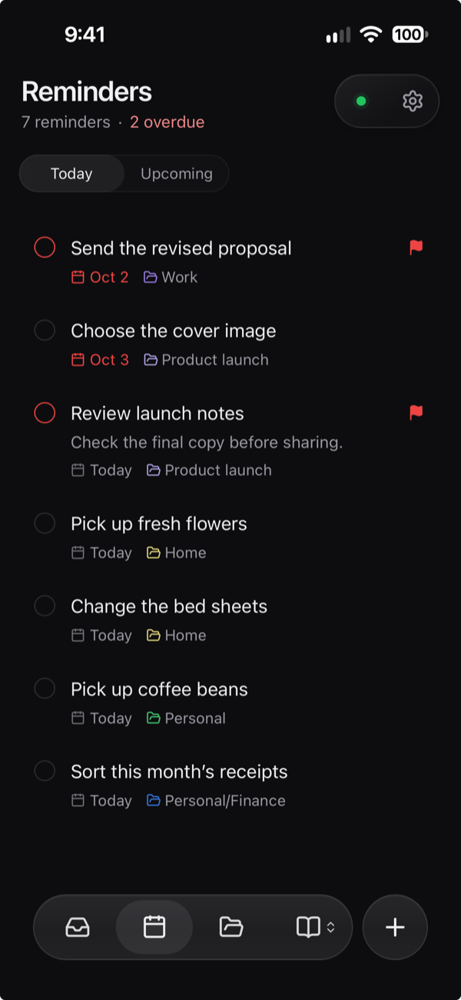
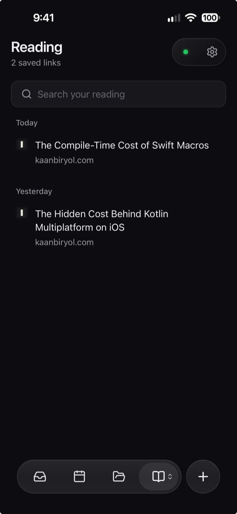

The Crate web app puts your reading list and reminders on your phone, no Obsidian needed. It runs from your own Crate server and installs to your Home Screen like a regular app.

It works with your Reading and Reminders folders only. For your whole vault, use Obsidian with the Crate plugin.

 

## Connect for the first time

1. On a connected Obsidian device, finish a sync.
2. Open **Settings → Crate → Crate web app**.
3. Select **Open app** to use this device, or **Connect another device** to show a QR code. **Copy link** gives you the same link to send to another device.
4. Open the link or scan the code on the device you want to connect.
5. Open a reminder or article you know is synced to check you're looking at the right vault.

Once connected, Obsidian can close. Your server needs to stay available.

:::caution[Keep connection links private]
Anyone with the link can open your library and reminders. If a link expires, create a new one in Obsidian.
:::

With encryption, follow the [unlock instructions](/docs/features/encryption/#reading-and-reminders-web-app) if the app asks.

## Install on your phone

**iPhone or iPad:** open the connected app in Safari, select **Share → Add to Home Screen**, then open the new icon within ten minutes. If you miss that window, use a fresh link. The installed app may ask you to unlock encryption again, because Safari and the Home Screen app keep keys separately.

**Android:** use your browser's install or add-to-home-screen option, then open Crate from the new icon. The wording varies by browser. You can also just keep using the browser tab.

Installing doesn't turn on alerts by itself. To get them, follow [notification setup](/docs/features/notifications/) in each app that should receive them.

## Make it yours

Open **Settings** in the web app to adjust appearance and preferences. Under **Tabs**, choose **Open app to** and reorder the tabs. Pick **Reading** to start in your library, or **Today** to start with your reminders.

These preferences belong to this browser or installed app. Feature switches, folders, and the notification schedule are managed in [Obsidian's Crate settings](/docs/features/settings/).

To save links from other apps, see the [Reading share options](/docs/features/reading/#read-on-your-phone).

## Before going offline

Open the web app while you're online so it can catch up. It saves your newest inbox articles in the background and keeps the articles you open, up to a limit. It doesn't download your whole library.

| What you're doing | Offline |
| --- | --- |
| Viewing reminders | Reminders you've already loaded stay readable. |
| Creating, editing, or completing a reminder | Reconnect first. A change you already submitted stays pending until it's confirmed. |
| Reading articles | Opened articles and your newest inbox articles are kept, up to 200 articles or 50 MB. Background copies are removed before articles you opened. |
| Saving links or editing saved articles | Changes wait on this device until you reconnect. Downloading new article text needs a connection. |
| Playing a saved YouTube video | Needs internet; Crate doesn't download videos. Saved transcripts stay readable. |

Your browser can clear its storage, and so can you. Think of the offline copy as a convenience, and let pending saves finish while the app is open and online.

## Check a pending save

Open **Settings → Sync** in the web app to see where Reading and Reminders stand, and select **Refresh all** to check again. If a change needs review, use the app's review or retry action and compare it with the confirmed version.

:::caution[Export before you clear or sign out]
Use **Export Reading data** or **Export unsynced reminders** when offered. If your session expires, pending work is kept for recovery. Selecting **Log out and clear device data** deletes offline data and drafts for both features on this device.
:::

For a stuck save, expired session, or missing offline copy, see [History and recovery](/docs/troubleshooting/recovery/#pending-work-in-the-web-app).
