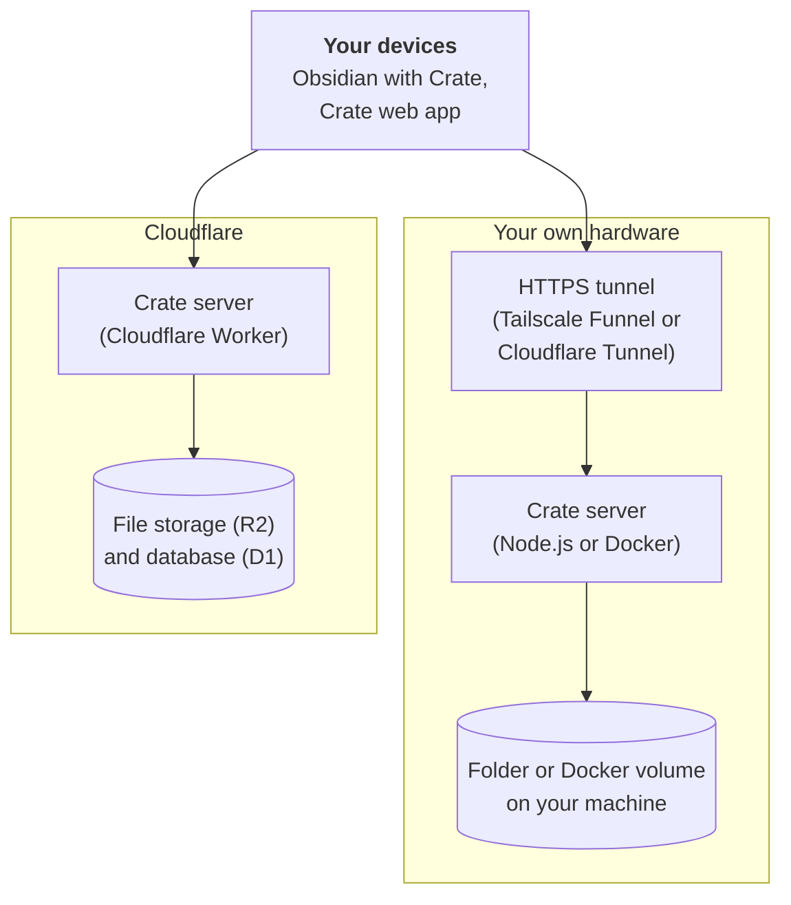

Vault sync and the web app need a Crate server. You decide where it runs, and you don't need a Crate account. There are two options:

- **Cloudflare:** Crate sets up a server in your own Cloudflare account. It stays online without your computer.
- **Your own hardware:** run Crate with one command, or with Docker, on a computer or server you manage. Your data is stored there.

| | Cloudflare | Your own hardware |
| --- | --- | --- |
| Setup | Connect your Cloudflare account in Obsidian | Run one command, or Docker, then scan a code |
| Where your data lives | Storage and a database in your Cloudflare account | A folder or Docker volume on your machine |
| Availability | Your computer can sleep | Your machine must stay awake and online |
| Address | A server address from your deployment | A permanent Tailscale address, your own domain, or a temporary tunnel address |
| What you look after | Cloudflare account, usage, and server updates | The machine, and running one command to update |

## Cloudflare

Choose Cloudflare if you want a server that's always available without keeping your own computer running. After you authorize Crate, it creates the server and storage in your account for you.

Before connecting, you need to turn on R2, Cloudflare's file storage. Cloudflare asks for billing details for this, and hosting charges may apply to your usage.

[Set up with Cloudflare →](/docs/getting-started/cloudflare/)

## Your own computer or server

Choose your own hardware if you want the server's files and database on a machine you manage. One command asks a few questions and sets up a permanent address with a free Tailscale account, start at login, and daily backups. You don't need a Cloudflare account or your own domain. Docker works too, including on Windows.

Your machine needs to stay awake and online for sync and scheduled notifications to work.

[Set up your own server →](/docs/getting-started/self-hosting/)

## One server for each vault

Connect copies of the **same vault** to the same server, and give each unrelated vault its own server. Vault names don't keep data apart: when you connect a vault to a server that already has files, Crate asks to replace everything in the vault with the server's contents. Select **Cancel** to keep the vault as it is.

## Privacy

Without [end-to-end encryption](/docs/features/encryption/), whoever runs your server can read your synced notes. Both options support it, and it starts off.
