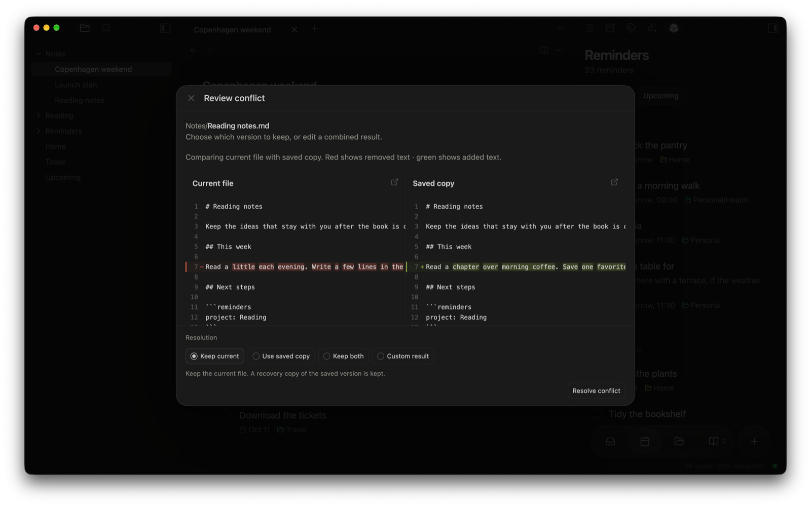

A conflict doesn't lose anything. Crate keeps both versions and waits for you to choose.

Conflicts happen when the same file changed in two places before they could sync. You compare the versions and decide what belongs in your vault.

## Resolve a conflict in a note

1. Open **Sync activity → Conflicts**.
2. Select **Review** next to the file.
3. Compare your current file with the saved copy. Red is removed text; green is added text.
4. Choose the current version, the saved version, both versions, or your own combined version.
5. Check the result, then confirm.
6. Open the note to make sure it looks right, then sync again.

If you build your own combined version, read the whole thing through before you confirm.

Not sure yet? Leave both copies in place while you think it over. Don't delete conflict copies just to clear the list.

## Attachments and binary files

When an existing image, PDF, or other non-text file changes, Crate asks you to review it too. It keeps and shows both files, but it can't blend them together like text.

Open each version in an app that can view it, then choose the one to keep.

## Avoid conflicts next time

- Let one device finish syncing before you keep editing the same note on another.
- After a long time offline, check your pending changes and let your devices catch up before you edit more.

If a conflict needs more time, turn off automatic sync on that device and back up its vault. Look through [file history and earlier vault states](/docs/troubleshooting/recovery/) before you throw anything away.
