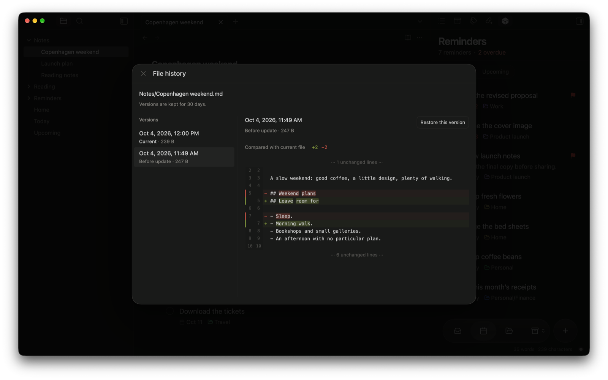
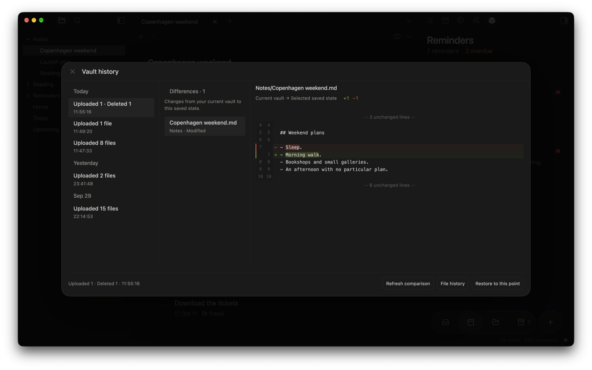

Lost a change? There's a good chance Crate still has it. Start with the smallest fix: one file, then your whole vault, then unsent work on a device.

## Get back an earlier version of a file

Your server keeps replaced and deleted files for 30 days. While you keep editing a file, it keeps the version from before you started and then about one version every 10 minutes, or every hour for files of 1 MB or more, so not every save is kept.

1. In Obsidian, open the file's menu and select **File history**, or run **Crate: Show file sync history** for the open file.
2. Pick an earlier version and compare it with what you have now.
3. Select **Restore this version**, check the note, then sync.

**Looking for a deleted file?** Open **Sync activity → History → File history**. Also check your vault's `.trash` folder, where files removed by sync from another device end up.

Files that only ever lived on one device may have no server history.

## Put your whole vault back the way it was

Crate saves recent snapshots of your synced vault, called checkpoints.

1. Before you start, back up your current vault and let any unsent web app edits finish.
2. Turn off automatic sync on your other devices while you work.
3. Open **Sync activity → History**, select **Browse vault history**, and pick a saved state from the list.
4. Review what would change, then select **Restore to this point**.
5. Confirm, then check the restored vault before turning automatic sync back on elsewhere.

Good to know

- Crate keeps the latest 20 checkpoints, for up to 30 days, and all your connected devices can see them.
- Restoring keeps local recovery copies of what it replaces.
- If a file was saved in the middle of an editing session, its exact version at that point may no longer be kept. Crate restores everything else, leaves that file as it is now, and lists it when the restore finishes.
- Files you've excluded on the restoring device aren't touched.
- If no checkpoints show up, [update your server](/docs/troubleshooting/updates/) and complete a successful sync.

## Pending work in the web app

If the app couldn't confirm a save, your draft or change is still there. Don't create the same item again; use the app's retry, edit, or review controls instead.

If your session needs renewing:

1. Reconnect to the same server and folder.
2. Review your saved work.
3. Select **Resume saved changes** when it's offered.

Export pending work before you clear browser data.

:::caution[Don't sign out to fix a stuck save]
**Signing out clears cached data, pending changes, and drafts.** Try the steps above first.
:::

## The app says "Offline copy unavailable"

1. Reconnect and close any old Crate tabs.
2. Select **Rebuild offline copy**. This rebuilds the app's saved copy and keeps your pending changes and drafts.

If that doesn't fix it, keep any export you have and write down the error before you change browser storage by hand.

## Crate's settings were damaged

If Obsidian closes while Crate is saving, its settings file can be left incomplete. On the next start, Crate moves the damaged file aside as `data.json.corrupt-<number>` in its plugin folder and tells you which of these it did:

- **Restored the last good copy:** Crate keeps a copy of the settings it loaded when Obsidian last started. Check your recent setting changes and make them again if needed.
- **Started with defaults:** sync is disconnected, and Reading and Reminders are off. Open **Settings → Crate** to reconnect to the same server, then turn the features back on.

Your notes aren't changed. Neither file holds sign-in credentials; those stay in Obsidian's secret storage.

## Keep a backup of your own

Crate's history only goes back so far, and deletions sync like any other change. Keep a separate backup of vaults that matter to you.

- **Self-hosted:** use the [verified backup and restore commands](/docs/reference/self-hosting/#verified-backups-restore-and-updates).
- **Cloudflare:** restoring the server's storage means restoring its database and file storage together. See the [operator recovery runbook](https://github.com/kaanbiryol/obsidian-crate/blob/master/docs/recovery.md).
