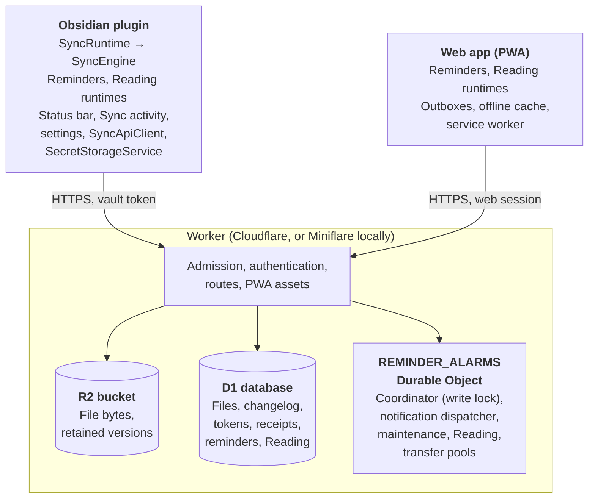

# Architecture

## Overview

The notification dispatcher sends reminder alerts to subscribed web apps through each browser's push service.

Crate has three hosts: the Obsidian plugin, the Reminders and Reading web app (PWA), and one Worker that runs on Cloudflare or locally through `packages/server`. The Worker serves the PWA.

**Design rule:** sync intelligence (change detection, conflict resolution, batching and planning) lives in the plugin. The Worker stores files and metadata, serves the API and the PWA, applies web app edits to Markdown, and schedules push notifications, but never decides a sync plan. Reminder and Reading rules live in shared modules (`reminders/core/`, `reading/core/`) so the plugin, the PWA and the Worker agree.

## Hosts and build products

| Host or service | Role |
|---|---|
| **Obsidian plugin** | `main.js` and `styles.css`, built by Vite into `dist/`. Plans and runs sync, indexes reminders and Reading notes, and deploys and manages Cloudflare servers |
| **PWA** | Reminders and Reading web app, bundled by esbuild (`scripts/pwa-client-build.mjs`) and served by the Worker under `/notifications` |
| **Cloudflare Worker** | HTTPS API for sync, reminders, Reading, settings and push; serves the PWA |
| **Cloudflare R2** | Object storage for vault file content and retained versions |
| **Cloudflare D1** | SQLite metadata; see `DB` under [Worker bindings](#worker-bindings) |
| **Durable Objects** | Named roles of one `ReminderAlarm` class; see [Durable Object roles](#durable-object-roles) |
| **Local server** | `packages/server/`: the same Worker in Miniflare behind a Node gateway, for self-hosting and Docker |
| **Cloudflare OAuth deployment** | PKCE in Obsidian provisions the bundled Worker and schema; the saved login stays in secret storage for explicit management and usage requests. See [deployment](deployment.md#deployment-code) |
| **Static GitHub Pages callback** | Removes OAuth parameters and hands the response to Obsidian; has no backend, analytics or token exchange |
| **OS keychain** | Credentials and keys through Obsidian's `secretStorage`; see [secret storage](#secret-storage) |

### Build

- `scripts/build-worker.mjs` builds the PWA client first, injects that bundle into the Worker build, and writes the deployable module to `.generated/cloudflare/worker.mjs`. PWA source lives in `src/pwa/`; its Worker-served HTML, install assets and service worker live in `src/cloudflare/worker/pwa/`. `src/cloudflare/worker/pwa/styles.ts` inlines the shell styles in `src/pwa/styles/host/` with the other PWA Sass.
- The production plugin embeds gzip-compressed copies of `.generated/cloudflare/worker.mjs` and `src/cloudflare/schema.sql`. `scripts/vite/cloudflare-artifacts-vite-plugin.mjs` computes their SHA-256 hashes at build time, and Obsidian verifies them after decompression before deploying. No Worker code or schema is fetched from the network at runtime.
- The current candidate initializes schema 1 in `crate_schema`; see the checked [current contract](current-contract.md). Provisioning initializes empty databases and leaves current ones unchanged, and Worker requests never run DDL. Future upgrades use the explicit manifest and checkpoint boundary in [server upgrades](server-upgrades.md). Unsupported schemas are rejected without modification. See the [compatibility matrix](compatibility.md).
- `npm run release:check` enforces Worker and combined-plugin size budgets and checks that the OAuth entry point remains in the plugin bundle.
- The plugin and PWA share React components and one React/React DOM runtime. Vite uses `@vitejs/plugin-react` for the plugin and the visual gallery; the PWA uses esbuild with the React JSX runtime. Browser test harnesses use the same packages. Obsidian mounts reminder views inside Shadow DOM, so editor selection and event handling are tested there as well as in the PWA document.

### Local server

`scripts/local-server.mjs` is a thin entry point into `packages/server/src/`, which owns the standalone CLI, HTTP gateway, tunnels, pairing, backups and runtime asset resolution. `scripts/package-server.mjs` copies that directory into the published package's `scripts/` directory and marks its manifest to select shipped assets: source execution uses repository assets, installed execution uses only the package. Miniflare provides D1, R2 and Durable Objects backed by a persistent data directory. A Node HTTP listener forwards only application requests; Miniflare's own listener stays on loopback. Schema and runtime compatibility are checked before Durable Objects start. See [self-hosting](self-hosting.md).

- `local-server-lifecycle.mjs` owns ordered teardown for the CLI and Quick Server. It drains the HTTP listener before closing the runtime, attempts remaining cleanup after individual failures, and preserves startup errors alongside cleanup errors. Runtime disposal releases the data-directory lock.
- The gateway owns single-use device pairing and an instance-specific public readiness probe. Pairing administration uses a private local socket and secret; only redemption is exposed through the tunnel.
- `local-server-backup.mjs` writes verified backups while the server runs: write-once blobs are copied while it keeps serving, and the rest is copied during a short write pause. A stopped server is backed up directly. `local-server-backup-schedule.mjs` runs one backup at a time, on request or daily when automatic backups are on. Restore needs a stopped server and an empty data directory. It validates checksums and compatibility, opens the restored database with alarms disabled, removes its storage identity so devices treat it as a new server, and writes `server.json` last as the publication marker.
- These features add no enrollment endpoints or migration behavior to Cloudflare-hosted Workers.
- `Dockerfile` packages the same runtime and a pinned tunnel connector. `compose.yaml` owns container lifecycle and the persistent `/data` volume. The entrypoint holds a kernel lease (`flock` on `/data/.server-lease`) across the CLI and its children, allowing crash recovery without two containers opening the database. Application behavior stays in the shared Worker and local launcher.

## Worker Bindings

`src/cloudflare/worker-runtime.json` holds the binding names, the Durable Object class, compatibility settings and the notification rate limit; the deployment payload and the local server both read it, and `worker-runtime.test.ts` keeps `wrangler.jsonc` in step. `src/cloudflare/deployment/worker-upload-payload.ts` builds the multipart metadata, plain-text bindings, export policy and module bytes for the normal and deletion Workers. `src/cloudflare/cloudflare-api.ts` owns authenticated transport, response handling and pagination. `packages/server/src/local-server-runtime.mjs` sets the same bindings in Miniflare. The Worker reads them through `Env` in `src/cloudflare/worker/types.ts`.

| Binding | Type | Set by | Purpose |
|---|---|---|---|
| `BUCKET` | R2 bucket | Deployment, local server | File content and retained versions |
| `DB` | D1 database | Deployment, local server | Files, changelog and retained versions; device and web tokens and one-time `grants`; `operations` receipts; push subscriptions and VAPID keys; notification policy, reminder sources and projections; the parsed reminder cache; the Reading policy, index, tags, search terms, highlights and extraction queues; upload leases and object cleanup; `server_state` (encryption state, feature policy, reset generation); `maintenance_state`; schema and release markers |
| `REMINDER_ALARMS` | Durable Object namespace (`ReminderAlarm`, SQLite storage) | Deployment, local server | Named roles: coordinator, notification dispatcher, maintenance and Reading, plus upload and read transfer pools |
| `NOTIFICATION_REQUEST_LIMITER` | Rate Limiting API | Deployment, local server | Limits unrecognized API credentials and sensitive actions per source before D1; verified sessions use a separate bounded sync budget. Without it, a bounded per-isolate fallback applies |
| `CRATE_DEPLOYMENT_FINGERPRINT` | Plain text | Deployment, local server | Fingerprint of the deployed artifacts. `/.well-known/crate` reports it as `deploymentFingerprint`, which deployment verification checks; Shortcut responses and the Reading save script carry it |
| `CRATE_PUBLIC_ORIGIN` | Plain text | Deployment, local server | The server's public origin, for push notification links and icons, and to refuse extracting the server's own pages |
| `CRATE_VAULT_NAME` | Plain text, optional | Deployment | The vault's name. The plugin reads it back from Worker settings to label servers during discovery; the Worker does not read it. Omitted when the vault has no usable name |
| `READING_FETCH` | Service binding, local only | Local server | Public-network-only outbound fetch. Miniflare's default outbound service allows private networks, so the local server routes Reading, page-title and other Worker fetches (such as push) through it. Hosted Workers use `global_fetch_strictly_public` instead |

The temporary deletion helper Worker has its own bindings: the selected `BUCKET` and the plain-text `CRATE_RESET_ID`, `CRATE_DELETE_TOKEN_HASH` and `CRATE_DELETE_UPLOAD_TAG`. See [deployment](deployment.md#deployment-code).

To add a binding, update `worker-runtime.json` or `worker-upload-payload.ts`, `Env`, `local-server-runtime.mjs` and `wrangler.jsonc`.

## Import boundaries

ESLint (`eslint.config.mts`) enforces these boundaries; the Worker and sync rules exempt tests and test harnesses:

| Code | May not import |
|---|---|
| Worker modules (`src/cloudflare/worker/`) | Anything outside an allowlist: `protocol/`, `encryption/`, `platform/`, `reminders/core/`, `reading/core/`, `reading/extraction/`, the Reading shortcut and settings modules, release metadata and schema, and the PWA shell modules the Worker renders (including the update screen and update markers in `pwa/shell/`) with the styles and pure modules they reach. `scripts/worker-import-boundary.mjs` also follows the runtime imports of allowed modules, so a shared file cannot pull host code in indirectly. Type-only imports are exempt; `obsidian` is always blocked |
| `src/sync/` | `reminders/`, `reading/` or `plugin/`. Features plug in through callbacks the plugin wires |
| Shared domain modules (`reminders/core/`, `reading/core/`, `reading/extraction/`, `protocol/`, `encryption/`, `platform/`) | `obsidian` |
| Shared UI (`ui/shared/`, `reminders/ui/{shared,reminder-editor,views,format}/`, `reading/ui/` except `reading/ui/plugin/`) | `obsidian` and the Obsidian adapters in `ui/plugin/` and `reminders/ui/plugin/` |
| `src/pwa/` | The Obsidian adapters, `PluginRemindersAppShell`, and `@base-ui/react/button` (use `ui/shared/Button` or `PwaButton`) |

Feature data reaches sync only through injection. In an encrypted vault, `plugin/note-projection.ts` builds each note's public data (its Reading card, else its reminder schedules) and the plugin passes it to `SyncRuntime`, which hands it to `SyncApiClient.configureEncryption`.

## Module map

Paths are relative to `src/`; `worker/` means `cloudflare/worker/`.

### Plugin and UI modules

| Path | Owns |
|---|---|
| `main.ts` | Bundle entry shell |
| `plugin/CratePlugin.ts`, `plugin/lifecycle.ts` | Plugin class, ordered load and unload, protocol handlers (`crate-cloudflare-oauth`, `crate-pair`, `crate-reminders`) |
| `plugin/settings.ts`, `plugin/settings-types.ts`, `plugin/plugin-data.ts` | Settings composition and persistence; plugin data versions and the last-good copy |
| `plugin/sync-integration.ts`, `plugin/sync-status.ts`, `plugin/sync-result-notices.ts` | Sync commands and Sync activity; sync indicator lifetime; sync result notices |
| `plugin/cloudflare/`, `plugin/self-hosted-connection.ts`, `plugin/connection-operation.ts`, `plugin/vault-replacement.ts` | Cloudflare operations and connection; self-hosted connection; one connection flow at a time; confirming vault replacement when joining a server that has files |
| `plugin/server-request.ts`, `plugin/server-setup.ts`, `plugin/shared-settings-sync.ts` | Guarded feature requests; repeatable server setup steps; shared settings pull and push |
| `plugin/note-projection.ts` | Public per-note data for encrypted sync |
| `plugin/device-pairing.ts`, `plugin/web-app-pairing.ts`, `plugin/web-app-enrollment.ts`, `plugin/encryption-setup.ts` | Device pairing links; web app key approval; web app setup links; encryption state checks |
| `plugin/crate-update/` | Copies Crate releases between the user's devices through the vault; a device installs only a strictly newer release |
| `ui/sync-status/` | Status bar and mobile header sync indicators; see [plugin UI](plugin-ui.md#sync-status) |
| `ui/activity/` | Sync activity: status, pending changes, history, restore and conflict review |
| `ui/settings/` | Settings tab sections and dialogs |
| `ui/cloudflare/` | Cloudflare deployment dialogs and presentation |
| `ui/plugin/` | Obsidian modal shells, native modal controls, `PluginRoot`, `PluginWorkspace`, Shadow DOM mounting |
| `ui/shared/` | Host-neutral components, navigation, icons and reduced-motion preferences |
| `ui/obsidian-icon/` | Obsidian icon renderer |
| `styles/` | Plugin stylesheet entry points |

### Sync modules

| Path | Owns |
|---|---|
| `sync/runtime/` | `SyncRuntime` lifecycle: startup sync, vault event gate, configuration workflows (connection, address, encryption reset), history workflow, server status, foreground sync |
| `sync/engine/` | `SyncEngine`: sync workflows, cancellation, shutdown draining, file operations, local change detection, exclusion cleanup, initial setup and import |
| `sync/planner/` | Full, incremental and local plans and reconciliation |
| `sync/transfer/` | Upload, download and delete execution, batching and byte budgets |
| `sync/queue/` | `SyncQueueController`: pending set, revisions, debounce and flush batches |
| `sync/pending/` | Pending change keys, previews, discard and verification |
| `sync/manifest/` | `LocalManifest`, checkpoint encoding, rename dependencies, storage paths |
| `sync/durability/` | Upload journal and intents, durable restores, recovery chunks, checkpoint backup cleanup |
| `sync/local/` | Vault file discovery, ignore rules, path safety, local apply and delete, stored names, vault replacement |
| `sync/conflict/` | Conflict copies, their store and review |
| `sync/merge/` | Markdown and text merges and the merge-base cache |
| `sync/history/` | File history, deleted files, restores and preview decoding |
| `sync/encryption/` | Encrypted file translation, path index, key storage, reset, encrypted connection |
| `sync/connection/` | Pairing, address, reachability and shared-settings rules; typed connection errors |
| `sync/diagnostics/` | Diagnostic checks and export, request and upload diagnostics, timings |
| `sync/worker-api/` | `SyncApiClient`: HTTP, read and mutation contracts, encryption guard |
| `sync/secret-storage.ts` | `SecretStorageService` |
| `sync/sync-outcome.ts`, `sync/settings.ts` | Sync attempts and published results; the sync settings slice |

### Reminders and Reading modules

| Path | Owns |
|---|---|
| `reminders/core/` | Shared reminder domain: parsing (`grammar/`), dates and timezones (`dates/`), recurrence (`recurrence/`), Markdown file commands, mutation plans, drafts and submission, list building, sort and identity |
| `reminders/data/` | `ReminderIndex`, `MarkdownWriter`, repository, vault scanner and watcher, editor normalization, strict UTF-8 vault access (`vault-markdown.ts`) |
| `reminders/editor/` | Editor and reading-view extensions: date chips, hidden ID and rule markers, description widgets and protection, ID assignment when the cursor leaves a line |
| `reminders/query/` | `reminders`, `reminders-today` and `reminders-upcoming` code blocks |
| `reminders/ui/` | Reminder views and editor for both hosts (`shared/`, `views/`, `reminder-editor/`, `format/`); Obsidian adapters in `plugin/` |
| `reminders/runtime.ts`, `reminders/register-integrations.ts` | The reminder backend for the loaded folder (index, writer, repository, watcher); commands, code blocks, views and editor extensions |
| `reminders/scan-gate.ts`, `reminders/local-notifications.ts`, `reminders/notification-policy-sync.ts` | Holding reminder writes during sync; device-local reminder notifications; server notification policy edits |
| `reading/core/` | Shared Reading domain: article blocks, filenames, frontmatter, highlights, mutation policy, cards and search terms |
| `reading/extraction/` | HTML extraction shared with the Worker |
| `reading/data/` | Vault adapter (`obsidian-vault.ts`), library, background maintenance, refresh batching, image cleanup |
| `reading/ui/` | Reader, library and highlight components for both hosts; Obsidian adapters in `plugin/` |
| `reading/runtime.ts`, `reading/register-integrations.ts` | Reading configuration, policy refresh, scheduling and cleanup; the view, commands, `crate-reading` links and editor extensions |
| `reading/desktop-capture.ts`, `reading/desktop-images.ts`, `reading/server.ts`, `reading/shortcut.ts` | Desktop article and image downloads through `requestUrl`; Reading policy requests; the Shortcut contract |

### Encryption and protocol modules

| Path | Owns |
|---|---|
| `encryption/` | Vault key bundle, authenticated file and settings formats, path tags and bindings, folder labels, inventory validation, notification keys |
| `encryption/pairing/` | Key approval state machine (`web-pairing-v1`) |
| `protocol/` | Wire formats, limits and validation shared by the plugin, PWA and Worker |
| `platform/` | Portable helpers (base64, SHA-256, stable JSON, validation) and secret key names |

See [e2ee implementation](e2ee-implementation.md#source-modules) for how the encryption modules fit together.

### PWA modules

| Path | Owns |
|---|---|
| `pwa/main.tsx`, `pwa/FeatureShell.tsx` | Mount and feature shell: providers and retained feature panels |
| `pwa/connection/` | App connection: enrollment, startup, credential changes, logout, browser setup, pairing client, typed issues |
| `pwa/encryption/` | Key verification and import, encrypted push, encryption-off trust, unlock |
| `pwa/sync/` | `PwaSyncProvider`, the overall sync indicator and feedback |
| `pwa/update/` | Update readiness, checks and activation |
| `pwa/reminders/` | Reminders runtime, sync state, editor hooks, outbox (`outbox/`) and offline cache (`cache/`) |
| `pwa/reading/` | Reading runtime, session (`session/`), storage (`storage/`), outbox and API clients |
| `pwa/settings/` | Settings sheet, store and preferences |
| `pwa/storage/` | Shared IndexedDB and browser storage helpers |
| `pwa/navigation/`, `pwa/hooks/`, `pwa/components/` | History and sheet navigation, shared hooks, PWA chrome |
| `pwa/shell/` | Modules the Worker renders into the shell: version, theme, opening screen, update screen and markers |
| `pwa/service-worker/` | Service worker runtime |

### Cloudflare deployment modules

| Path | Owns |
|---|---|
| `cloudflare/deployment/` | Deployment requests and target selection, provisioning, updates and recovery, discovery, the deployment fence, the Worker upload payload, device registration and pairing codes |
| `cloudflare/oauth/` | PKCE, OAuth session, saved Cloudflare login |
| `cloudflare/restore/` | Upgrade backups and isolated restore |
| `cloudflare/server-reset/` | Terminal server deletion and its helper Worker |
| `cloudflare/usage/` | On-demand Cloudflare account usage and its cached snapshot |
| `cloudflare/cloudflare-api.ts` | Authenticated Cloudflare API transport, pagination and rate-limit waits |
| `cloudflare/schema.sql`, `cloudflare/server-release.json`, `cloudflare/worker-runtime.json` | Schema, release metadata, Worker runtime settings |

See [deployment](deployment.md#deployment-code) for how these fit together.

### Worker modules

| Path | Owns |
|---|---|
| `worker/index.ts`, `worker/request-handler.ts`, `worker/request-guards.ts`, `worker/router.ts` | Entry points; admission, authentication and guard ordering; stateless protocol and encryption checks; dispatch |
| `worker/routes/` | Route policy (`policy.ts`) and per-domain dispatchers |
| `worker/admission/` | Rate limiting and admission hints before D1 |
| `worker/auth/` | Token authentication, revocation, web enrollment, device pairing redemption |
| `worker/http/` | Body limits and reading, CORS, request validation, mutation audit logging |
| `worker/coordinator/` | `ReminderAlarm` Durable Object: role names, internal endpoints, alarms |
| `worker/sync/` | Sync API and the committed-file store: identity guards, Markdown staging and commits, change tokens, batches, staging and leases, initial import, file versions, history checkpoints |
| `worker/reminders/` | Reminder handlers, parsed cache, source parsing and identity, operation receipts |
| `worker/notifications/` | Projection queue and passes, dispatcher, push delivery, subscriptions, notification policy |
| `worker/reading/` | Reading access, queries, mutations, captures and extraction jobs, encrypted extraction, Shortcut transport |
| `worker/encryption/` | Encryption state, reset, descriptors, folder labels, receipts, pairing relay |
| `worker/maintenance/` | Scheduled cleanup of the database, objects, upload leases, receipts and reminder history; diagnostics |
| `worker/server/` | Server info and health, feature policy, history retention, page titles |
| `worker/d1/` | D1 helpers, operation receipt floors, usage metering, platform limits, server state |
| `worker/pwa/` | PWA HTML, assets, install files and service worker |

## Subsystem notes

### Plugin host

**Settings.** `plugin/settings-types.ts` separates persisted settings from the runtime device ID. Loading initializes settings before hydrating that ID from secret storage. Sync owns its settings slice, defaults and validation in `sync/settings.ts`; `plugin/settings.ts` composes it with the Reading, Reminders and deployment slices. Queued settings writes use `publishSavedSettings` to publish only the requested normalized fields after saving; snapshot saves do not republish captured state. `updateSyncProgress` in `sync/settings.ts` is a narrow synchronous sync-progress update with bounded, immutable history. Sync keeps cursor and checkpoint ordering and persists at operation completion. This preserves newer progress during unrelated settings saves, the hydrated device identity and the existing shared settings object.

**Shared settings and policies.** `protocol/shared-settings.ts` defines and validates shared settings for both hosts. `protocol/feature-policy.ts` and `protocol/reading-policy.ts` do the same for the `/features` and `/reading/policy` contracts; `reading/server.ts` wraps the plugin's Reading policy requests. `sync/connection/shared-settings.ts` applies shared settings to plugin settings and rebases this device's changes onto the server's version before a conditional write.

**Server requests and connections.** Plugin feature requests use `plugin/server-request.ts` for validated server metadata and lifecycle and connection guards before dispatch and after responses. Reading adds its own capability requirements; shared feature settings require only their own capability. `plugin/cloudflare/connection.ts` and `plugin/self-hosted-connection.ts` connect a device across the plugin's runtime, settings and deployment state; `sync/connection/` keeps pairing, address, reachability and shared-settings rules. Cloudflare operations are described in [deployment](deployment.md#deployment-code).

**Sync activity.** `ui/activity/activity-modal.ts` owns the Activity view's subscriptions and rendering; `activity-header.ts` renders its sync status, sync and stop control, and sync error notice. `openSyncActivity` in `plugin/sync-integration.ts` gives the modal the same **Sync now** and **Stop sync** actions as the commands; the modal keeps only the stopping state. `shared-history-loader.ts` coalesces requests and handles disposal for each open view, keeps available history on failure and ignores late responses after close. `activity-status.ts` derives labels, indicators and button state without touching the DOM. Conflict panel rendering stays with the modal. The status bar is described in [plugin UI](plugin-ui.md#sync-status).

**Shared UI.** The plugin and PWA share dock presentation, the Today/Upcoming switcher, tab dissolves and project push/pop transitions in `ui/shared/navigation/`, alongside reminder panels, cards and view-model logic. Reading and Reminders share the view header, navigation bar, buttons, icon buttons and modal header in `ui/shared/`; feature adapters supply destinations, actions, data and lifecycle behavior. Host adapters keep viewport, safe-area, modal, persistence and history behavior. Every plugin React root renders inside `PluginRoot` (`ui/plugin/PluginRoot.tsx`), which provides the plugin and Obsidian's icon renderer to shared components. `PluginWorkspace` keeps visited Reminders and Reading screens mounted in one Obsidian pane, reads local vault repositories and stores dock choices in Obsidian device-local storage; existing view types and commands remain supported. Reading runtime subscriptions replace or remove the mounted library when its configuration changes. Reading highlight controls keep saving and copy/share feedback in `ReadingHighlightActions`; `reading-highlight-interaction.ts` owns selection, gesture listeners and cleanup, and `reading-highlight-geometry.ts` places the overlay from measured rectangles. Both hosts compile the same semantic theme tokens; see [UI styling](ui-styling.md).

### Sync engine

See the [sync pipeline](sync-pipeline.md) for the end-to-end flow and the [protocol](protocol.md) for wire guarantees.

#### Runtime and configuration

- `SyncRuntime` (`sync/runtime/runtime.ts`) owns lifecycle. `startup-sync.ts` runs the startup sync, and the runtime keeps initialization revision checks. `vault-event-gate.ts` admits vault events to the current engine; it records the events that arrive during the startup sync and replays them when the sync finishes.
- `connection-workflow.ts` owns connecting and disconnecting, including validation, credential revocation, local state cleanup and settings persistence. `encryption-reset-workflow.ts` owns the durable remote reset, local invalidation and upload sequence, whether it turns encryption off or on. `address-workflow.ts` owns verified encrypted connection and reset-address moves.
- `SyncRuntime` serializes these configuration changes and supplies stop, drain, initialize and cancellation checks; workflows do not calculate lifecycle generations or register events. The configuration queue captures authority when it accepts each operation and verifies it before dispatch; workflows also check it after asynchronous work. Shutdown invalidates queued resets, address changes, connection changes and encryption setup even when the caller supplies no cancellation signal. `sync/connection/connection-errors.ts` defines stable codes for owned setup failures, which settings uses to keep recovery guidance while redacting unknown transport failures.
- `history-workflow.ts` keeps pause, persistence, application, sync, verification and resumption together; the runtime supplies connection identity checks and the ordinary sync-operation wrapper.
- `server-status.ts` owns version caching and delayed reachability probes for manual sync. `SyncRuntime` supplies the current client and an idle-engine guard, resets probes during lifecycle changes and keeps foreground sync policy. Server observations cannot publish after a newer sync, shutdown or engine replacement.
- The sync HTTP client binds compatibility checks, dispatch and response publication to one connection generation. Replacing credentials or the lifecycle signal invalidates older work, including mutations waiting on cached compatibility data. Shared-feature operations keep that identity across consecutive requests, queued settings writes and backend and UI publication. Already dispatched Obsidian requests cannot be cancelled; durable operation reconciliation handles uncertain remote writes.

#### Engine lifecycle

- `sync/engine/contexts.ts` builds the transfer, workflow and queue contexts once, binding planners and transfers directly to their dependencies; only the planners that snapshot settings are built per sync. The engine supplies live state, pending paths, lifecycle guards and reconciliation; planner and transfer calls do not go through engine forwarding methods. Planner cancellation checks, transfer baseline reads and workflow setup completion are required context dependencies, including in test fixtures.
- Every sync entry (standard, forced, queue flush and queue reconciliation) starts through `beginSyncAttempt` in `sync/sync-outcome.ts`, which publishes every result and shows the reconnect notice once per authorization failure. Results carry an explicit completed, cancelled or failed outcome. Cancellation keeps transfer counts and diagnostics but publishes no successful sync, history checkpoint or error notice; aggregation and finalization preserve cancellation rather than inferring completion from an empty error list.
- `initial-setup.ts` orders the initial configuration pull and reminder setup. `sync()` runs an unfinished server initial import (`initial-import.ts`) before reconciliation; there is no separate initial-sync mode.
- The engine keeps cancellation, exclusive-operation checks and active-work tracking, including local and shared checkpoint saves. Shutdown drains those writes, accepted conflict mutations, background recovery and Markdown-cache work before a replacement engine can load their files, and the runtime attaches a completed checkpoint only while its originating engine is current. The conflict store closes after its producers settle, finishes queued writes and rejects new mutations; serialization within one store cannot protect replacement stores.
- `file-operations.ts` binds durable uploads, restores and rename deletion guards to one engine's manifest and Markdown cache. Planners, transfers and the queue receive this required handle; `SyncApiClient` keeps its raw endpoint methods and its HTTP, protocol and encryption concerns. Restore writes take part in shutdown draining, and the runtime finishes a restore only after successful reconciliation by the same engine.
- `exclusion-cleanup.ts` binds a cleanup review to its original paths, hashes, revisions and exclusions. The engine keeps exclusive mutation admission and lifetime checks, and the runtime rejects reviews from a replaced engine. Execution cannot add newly discovered remote files to a reviewed deletion set, and acknowledged deletions are saved before cancellation is reported.

#### Local changes and the queue

- `sync/engine/local-changes.ts` finds local edits that fired no vault event: the startup scan while automatic sync is off, content checks of same-metadata edits, and verification that pending paths are unchanged before the queue settles them.
- `sync/engine/pending-changes.ts` owns pending previews, discard preparation and post-sync baseline verification. `SyncQueueController` owns the pending set, its revisions, event coalescing, debounce timing and accepted flush batches. Each batch captures its revision snapshot and releases its in-flight paths once before publishing idle or error, so result recording can overlap a later transfer without an older finalizer clearing that transfer's pending work. Queue revision tracking and settlement snapshots are required dependencies, so settling an earlier upload cannot bypass the guard for a newer local edit. Discard keeps baseline persistence and queue settlement in one ordered operation.
- `sync/pending/pending-change.ts` owns the operation and path keys used by the queue, reconciliation, discard and Activity selection. Deletion keys use a marker that cannot occur in a valid sync path, so a file named `delete:note.md` remains an ordinary upload. Keys are volatile and rebuilt from local files at startup, so they do not affect checkpoints or the wire protocol.

#### Planning and transfer

- `sync/planner/incremental.ts` owns incremental phase ordering, progress, manifest saves and cursor advancement. `incremental-changelog.ts` reads a deduplicated snapshot without changing the saved cursor. `incremental-remote-reconciliation.ts` checks current local bytes and applies guarded local deletes together; it returns newly discovered local edits rather than mutating the scan inventory. Remote deletes apply only after the preceding phases succeed. These helpers own no engine cancellation or runtime lifecycle state. `sync/planner/types.ts` owns `FullSyncPlan`, shared by the planner and the workflow that applies it.
- `sync/transfer/upload.ts` and `sync/transfer/delete.ts` own ordinary transfer execution across sync modes. Automatic queue adapters keep revision settlement and retry scheduling and delegate batching, concurrency, acknowledgements and manifest updates to these executors. `delete-batches.ts` bounds deletion requests and drains accepted siblings on cancellation. Sync modes supply their planning and conflict-reconciliation policy. `upload-pipeline.ts` prepares the next byte-budgeted chunk while the current one uploads; full, forced, incremental and queued sync and Markdown republishing pass their preparation, retry, failure and progress policy. `transfer/process.ts:applyDiffs()` applies remaining diffs in order, and `transfer/delete.ts:createDeleteCandidates()` records a delete without a known remote version instead of sending it.

#### Manifest, history and previews

- `sync/engine/history.ts` owns sync history checkpoint and restore policy. `sync/manifest/manifest-checkpoint.ts` owns checkpoint parsing, encoding and recovery equivalence; diagnostics stay outside recovery equivalence. `LocalManifest` keeps generation selection, file I/O and ordered saves. Its baseline readers expose readonly views with stable entry identities; mutations replace entries through the manifest so revision tracking and checks across asynchronous reads agree. `RenameDependencies` (`sync/manifest/rename-dependencies.ts`) indexes renamed baseline paths by their current location and applies file and folder moves.
- `sync/history/preview-format.ts` owns text decoding and binary control-character rejection. `protocol/sync-limits.ts` owns the 256 KB preview limit shared with the Worker's version preview route. Each preview loader keeps its storage access and integrity checks. File history hides the UTF-8 BOM for display; pending diffs, restore comparisons and conflict review preserve it. Conflict review keeps its separate 1 MB edit limit.

#### Write and deletion safety

Sync deletes require both the acknowledged content hash and the opaque file revision. Recreating the same bytes produces a new revision, so an old delete cannot remove the new file; missing revisions require reconciliation. Applying a remote deletion locally always uses vault trash, so bytes written after the hash check remain recoverable. Updates whose old and new bytes are both strict UTF-8, outside known binary formats, use Obsidian's atomic process API whatever the extension. Existing binary files are preserved and incoming bytes saved as conflict copies for explicit review, because Obsidian exposes no atomic binary compare-and-swap. See [backup and recovery](recovery.md).

### Reminders

#### Index and scanning

- `reminders/data/reminder-index/index.ts` owns reminder record changes, including file renames. `lookup-store.ts` maintains derived lookup maps: the owner removes old keys before changing records, then adds the updated records before notifying subscribers. Scan failure keeps the last published records and lookups together. A full load that holds back individual files (a move awaiting review, deferred duplicate repair) publishes every other file and keeps those files' previous records until a later rescan can read them safely. `file-scan-result.ts` applies one file's scan result; queueing, invalidation and deferral stay in `index.ts`.
- `reminders/data/vault-watcher.ts` debounces vault events, and the index serializes accepted scans without a second time-based filter. Delete and rename events invalidate queued and in-flight scans for their paths, and a full scan re-reads its inventory if one of those events occurs before publication. The same invalidation stops the scanner's ID normalization, so a late read cannot rewrite a note after it moves out of the reminder folder. Immediate index updates stay authoritative over older asynchronous reads.
- Reads never wait for sync: the index is derived from Markdown, and vault events correct whatever sync changes afterwards. `reminders/scan-gate.ts` holds only writes (IDs, typed dates, duplicate repair) while `SyncRuntime.isWritingVault()` reports a sync that may change vault files. A note that needs a write meanwhile is indexed without the lines that write would change and is written on a later flush; a sync starting mid-load does not restart the folder scan. Reading follows the same rule.
- The index advances `getVersion()` before each change notification. Obsidian reminder views read it through `useReminderRepository`, a `useSyncExternalStore` hook that selects again after an index change, after a folder change publishes a new backend, or after an explicit refresh following a user action.

#### Editor writes

Rewriting a note under its editor can drop unsaved typing, so `reminders/data/editor-normalization.ts` writes normalization (identifiers, typed dates, duplicate repair) of a note shown in a loaded source-mode editor as one editor transaction of the changed spans. Obsidian copies it to the note's other tabs and saves the file. The write requires the editor text to equal the scanned note; otherwise the editor's save starts the next scan. The line under a focused cursor is left for a retry two seconds later. Deferred background tabs, reading views and closed notes use `vault.process`, which skips a note that gained an editor during its read; a `layout-change` flush retries it. Skipped lines are indexed once written.

#### Shared reminder rules

- `reminders/core/reminderDescription.ts` owns description encoding and attached comment parsing; `markdownReminderFile.ts` keeps reminder lookup, guarded replacement, deletion and reordering. Parser errors carry a stable category and source line through the plugin scanner and index to presentation; the original reason remains available for logs and callers without structured diagnostics.
- `reminderMutationPlan.ts` normalizes create and update inputs for the plugin repository, shared file commands and Worker routes. Its update contract belongs to the domain; core code does not depend on the Obsidian writer interface. Repository queries and optimistic fallback records stay in the data layer.
- `reminderFileCommand.ts` applies web app edits to Markdown notes. Encrypted web apps run it in the browser. The plaintext Worker routes in `worker/reminders/handlers/` run it, then add operation receipts, identity checks, conditional writes and parsed caches (`worker/reminders/cache/`), and map its failures to their released responses. `worker/reminders/plaintext-parity.integration.ts` records where those differ from the web app's answers.
- `reminder-list.ts` builds the web list from parsed notes for the Worker index and encrypted web apps: every copy of a duplicated identity is hidden and each affected file reports one issue. Its `compareProjects` orders projects in the plugin too. `worker/reminders/list-parity.integration.ts` checks that both lists agree.
- Reminder editing uses semantic revisions captured when the form opens, plus file compare-and-swap at commit. Web mutations require an operation UUID; the transaction persists a request hash and response receipt alongside the file update, so retrying a committed request replays its result. Creation IDs remain reserved after deletion (`reminder_identities`). Timed reminders persist UTC instants; recurrence metadata keeps timezone, count, end date and completion progress in a Markdown comment tied to the visible rule.

#### Schedule parsing

- `reminders/core/grammar/reminderSchedule.ts` resolves schedule spans for both editors. Highlighting, draft metadata and saving consume the same result: a Chrono date or a recurrence rule from the shared repeat grammar. No phrase is identified and then reinterpreted by a separate parser. Timezone suffixes use Chrono's abbreviations and offsets; IANA names use the platform timezone database. Recurrence calculations use `@internationalized/date`: named zones follow daylight-saving changes, while explicit offsets stay fixed. Editors display non-local recurrence zones and keep them through title, priority, project and repeat-picker edits.
- The repeat grammar owns the cadence, weekday lists and ranges, and monthly day. `dates/reminderTime.ts` delegates the following time phrase to Chrono, keeping its complete span and time precision, so forms such as `every Monday at 9 in the morning` stay recurring. A bare `Monday 9` implies no time when Chrono leaves the number as text. Seconds, fractional seconds and timestamps follow Chrono's recognition. Repeat time ranges cannot fit the single-time recurrence rule. Calendar dates following a repeat remain separate schedules, subject to the last-schedule rule.
- One-off calendar recognition also belongs to Chrono. Dates, times and timestamps are not prevalidated or partially masked: when Chrono returns no match, the full phrase remains title text. Durable reads use the same recognition and require recognized schedules to be absolute.
- `reminderDraft.ts` reconciles parsed text with the current draft. Both editors pass already-parsed metadata, preserving relative dates across renders. The plugin keeps implicit initial-date provenance; the PWA keeps explicit timezone defaults and converts canonical dates into local fields.
- `reminderSubmission.ts` resolves the latest editor text into saved reminder fields for both hosts, including recurrence removal before draft effects settle and preservation of an unchanged occurrence's exact timestamp. Adapters keep modal callbacks, split date and time inputs, and API null/undefined encoding. Index and shared views reuse the calendar membership rules in `dates/reminderDate.ts` and `reminderSort.ts`; each index or repository query captures one time snapshot.

Server-side notification scheduling and delivery are described in [notification processing](notification-processing.md).

### PWA

#### Shell and connection

- `pwa/main.tsx` mounts the feature shell. `pwa/FeatureShell.tsx` composes providers and renders the retained feature panels. `pwa/hooks/useFeatureNavigation.ts` owns feature and settings history, dock selection, interruptible section transitions and focus restoration as one lifecycle. The dock switches sections directly through a Reading navigation adapter and the reminder shell; feature switching and per-section state retention stay in the feature shell. Reading owns its article layout and typography, while common controls use the same host tokens.
- `pwa/connection/AppConnection.tsx` owns the app connection: enrollment, startup, credential changes, service-worker registration and logout. Reading connects with the existing app credential after enrollment completes. `AppConnectionGate` presents one unlock and reconnect surface above the feature screens; a failure confined to one feature still allows opening the other. When the startup encryption check gets no answer on a device without encryption evidence, both features show their plaintext offline copy read-only under a **Couldn’t connect** banner, with writes locked. Expired credentials are matched against the current connection before suspension; expiry preserves drafts and pending changes, while explicit logout clears both features' local data.
- Scope-specific encryption adapters share verification and key-import policy through `pwa/encryption/encryption-verification.ts`, keeping their own local storage migration and cache responsibilities.
- `pwa/connection/api-fetch.ts` is the app credential's feature-neutral transport. Reminders supplies its encryption check, encrypted router and folder-change handling (`pwa/reminders/reminder-transport.ts`), and `pwa/encryption/encryption-off-trust.ts` keeps the unencrypted verdict that lets a change skip the probe for 30 seconds. Reading sends through its own `pwa/reading/api.ts` and checks before every plaintext body. Connection boundaries publish typed issues from `pwa/connection/issues.ts`; recovery screens choose cleanup, reconnect or retry actions from the issue kind, not its display message.
- Mobile enrollment links first show `pwa/connection/BrowserSetup`: **Continue to web** opens the browser UI and remembers that preference; **Install Crate** reveals platform instructions while feature screens stay unmounted. Enrollment and local key import can finish behind this choice, and imported keys survive page reloads. Standalone launches bypass it. The preference contains no credentials and does not replace the installed app's encryption unlock. Browser storage does not transfer into an installed iOS app.

#### Sync status and updates

- The PWA mounts one `PwaSyncProvider` under the application shell. It owns the Reading and Reminders runtimes independently of their screens, so pending work resumes without visiting either section. Feature adapters keep their own queues, storage formats, API endpoints and confirmation rules. Pausing a feature stops new sends and refreshes while keeping its local hydration, recovery state and settings actions; already dispatched operations can still settle safely.
- Both feature runtimes publish their settings model with `useFeatureSettings`. Callbacks are published as stable functions that call the latest render's, so `pwa/settings/settings-store.ts` skips a model whose fields are unchanged, and Settings, the sync indicator and the update provider render again only when the fields they read through `useSettingsSelector` change.
- `pwa/sync/state.ts` derives the overall indicator and update readiness from both runtime registrations. Each feature publishes the policy from `pwa/update/update-readiness.ts` and a synchronous guard for work awaiting durability. An uninitialized feature is unverified, a hydrated paused feature remains ready for settings and logout, and paused or disconnected pending work still blocks updates. Reading queues commands in its runtime, so waiting for Web Locks or IndexedDB blocks updates before a pending record exists. Reminder command preparation publishes readiness changes and supplies its guard before React commits. The final update path rereads durable queues and drafts independently of the status model, and activation and reload recheck the synchronous guard after asynchronous storage reads, covering the interval before a command reaches its outbox.
- Both headers open the shared sync details. Refresh dispatches independently to enabled features, and logout clears both private views while credential revocation and storage cleanup finish. Sync feedback, including remote logout warnings, lives above the feature screens.

#### Service worker

`pwa/service-worker/runtime.ts` owns typed service-worker event handlers, including offline shell caches, update activation, encrypted push, push subscription renewal and Reading shares. It is compiled with WebWorker globals into a version-neutral bundle before the PWA asset version is calculated; `worker/pwa/service-worker.ts` supplies the final version and chunk URLs. The runtime bundle and its transitive inputs take part in asset hashing and server revision checks. Cache policy and browser message formats stay in the runtime.

#### Reminders in the PWA

- `pwa/reminders/RemindersRuntime.tsx` composes reminder data, session, outbox and editor hooks independently of the screen. Its screen-facing contract groups connection, sync, mutations, editor, status and presentation models. The always-mounted provider keeps hydration, recovery and update-readiness registration while the reminders screen is hidden.
- `useReminderSync` owns the confirmed snapshot, hydrates it from the offline copy after startup and exposes reads and explicit commit and reset operations. Its loading, refreshing, data mode and error transitions are the pure reducer in `reminder-sync-state.ts`; the hook keeps effects, requests and refs. `reminder-list-response.ts` decides what a list response or failure means (304, invalid body, disk fallback), and the hook applies that outcome. Indexing progress is separate from failure state, so an HTTP 202 preparation response remains a syncing status without recovery attention.
- `useReminderEditor` owns editor presentation, synchronous tap opening, close transitions, recovered drafts and session reset. `useReminderEditorActions` owns edit eligibility and save and delete completion: drafts and editors stay open until durable enqueue succeeds in the current session. `useReminderMutations` prepares and queues commands and exposes a synchronous preparation guard for updates, without controlling the editor. `useReminderProjectNavigation` keeps browser history, project exit completion and focus restoration together; `PwaRemindersAppShell` renders that navigation state.
- `pwa/reminders/outbox/reminder-outbox.ts` owns automatic retry eligibility. Mount, foreground, connectivity and timer wakeups honor the stored deadline and attempt budget; explicit retry and earlier-session recovery reset that budget while keeping the operation identity and request bytes. Outbox consumers cannot replace its refs or React state. `PendingReminderChange` ties each command kind to its required fields, HTTP method and endpoint. Storage validation remains the boundary for persisted records; the type does not reconstruct saved commands or change their request bytes.
- `reminder-outbox-events.ts` groups browser wakeups and cross-tab confirmation listeners under one subscription lifetime. `useReminderOutbox` keeps queue initialization, recovery and session ownership; delayed work from a disposed subscription cannot trigger a new refresh or error toast.

#### Reading in the PWA

- Reading's adapter separates durable state from its screen. `useReadingSession` owns durable hydration of articles, drafts and pending changes, and session-checked publication methods; `pwa/reading/session/useReadingConnection.ts` handles connection readiness, and the app connection hooks own enrollment and unlocking. `useReadingSync` owns refresh serialization (the connection check, queue drain and list load), retry scheduling and foreground and cross-tab refresh. Storage events are limited to Reading credentials, shared authentication and logout, and storage clears, so unrelated preference or reminder edits do not fetch the library. `useReadingMutations` owns capture, metadata edits, extraction retries and synchronous update guards in the mounted runtime, and `useReadingArticle` owns article loading, browser history and stale navigation guards. The runtime provider composes these owners and publishes settings; the application component owns presentation and invokes commands.
- Durable Reading records are validated at the storage boundary before the hooks publish them or the queue dispatches them. `pwa/reading/outbox.ts` owns typed commands, exact dispatch bytes, dependent-edit ordering and retry eligibility. Automatic refreshes honor the persisted deadline and three-attempt budget, while an explicit refresh can retry uncertain commands. Rejected commands remain for review; after exporting one (or the queues of an earlier sign-in, whose receipts can never settle), settings can remove it while the stored record still matches the export. Settings deadlines and failure announcements use the same outbox policy: transient errors remain visible, while toasts wait until automatic recovery stops or review is required.
- `pwa/reading/storage/cache.ts` owns the offline copies the user saves and, in one guarded transaction after a confirmed load, `removeEarlierSessionCopies`, which removes an earlier sign-in's readable copies. `pwa/reading/storage/database.ts` owns database lifetime and raw encrypted values. `pwa/storage/single-store-database.ts` shares bounded opening, schema validation and late-request fencing with the encryption databases; Reading keeps its cached connection, and each feature keeps its own records and transactions.
- `pwa/reading/session/session.ts` owns session authority. The storage facade exposes specific draft, pending-command, share and immutable-attempt operations, keeping raw keys inside persistence and migration code. Export and logout keep their recovery guards. `pwa/reading/session/reminders-session.ts` signs into Reading with the Reminders credential.
- `pwa/reading/api.ts` keeps pagination and response validation, including `loadReadingArticle`. Network and cache reads share item and article validation in `pwa/reading/storage/record-validation.ts`; live articles must match the requested identity and enrolled folder before the reader or offline cache receives them. List pages are validated before accumulation. The loader rejects repeated cursors and bounds page, item and issue counts before committing a complete cache revision, so rejected pagination leaves the prior cache and unsettled commands available.
- Encrypted Reading uses the trusted plugin or PWA for decryption, indexing, extraction and Markdown edits. `pwa/reading/encrypted-api.ts` owns the conditional ciphertext transport; `pwa/connection/` owns app enrollment and shared verification, while `pwa/reading/session/encryption-session.ts` and `pwa/reading/storage/private-storage.ts` adapt that readiness to Reading's protected local storage. The Worker stores ciphertext and public key and policy metadata; its plaintext Reading projector and extractor serve only unencrypted vaults. See [Reading encryption](reading-e2ee-assessment.md).

### Reading

#### Vault access and library

- `reading/data/obsidian-vault.ts` binds snapshots to Obsidian file identities and owns discovery, guarded reads and writes, and file-event revisions. Like reminder edits, its reads and writes go through `reminders/data/vault-markdown.ts`, so a note that is not strict UTF-8 is listed as an issue instead of being rewritten with replacement characters. `reading/runtime.ts` owns configuration, policy refresh, scheduling and lifecycle cleanup.
- Background work runs whether or not Reading is open: `reading/data/maintenance.ts` imports clips, records highlight markers and runs the strict check on each changed note. As with reminders, the library refreshes during sync while imports and highlight records wait. The card list, `reading/data/library.ts`, is built only while a Reading view or an action uses it, from Obsidian's frontmatter cache through the adapter's `cachedProperties`. It reads only notes the cache has not indexed or fails to validate, or that changed while the list exists. Vault events and actions update one note's entry, keeping the list sorted and duplicate IDs current. The web app reads the library from the server a page at a time ([Reading search](reading-search.md)). See [Reading at large library sizes](reading-scale.md).
- `ReadingLibrary.close()` closes admission and drains its accepted mutation and capture queues. Runtime shutdown waits for it alongside refreshes; replacement libraries defer vault access until the previous runtime has drained.
- `reading/core/mutation-policy.ts` shares edited-field preconditions and empty-capture checks across the library, the encrypted client and the plaintext Worker. Transport authorization, extraction consent and atomic publication stay with their hosts. The Worker's `worker/reading/queries.ts` owns item and list queries and payloads; its route admits reads only after authorization and complete projection.

#### Capture and extraction

- Desktop Obsidian saves a local bookmark before downloading its source through `requestUrl` (`reading/desktop-capture.ts`). `ReadingLibrary` serializes downloads separately from vault mutations, so the user can keep reading or editing notes. An empty local bookmark is stored as `unavailable`, which keeps the Worker from extracting it independently while normal sync runs; the reader shows an in-memory downloading state. A successful download conditionally fills only that bookmark's empty managed article block, preserving current metadata and personal notes outside the block. Deleted, replaced or modified article blocks, changed identities, duplicates and stopped runtimes reject late publication. A failed or interrupted download remains a retryable bookmark.
- `reading/core/article.ts` owns article block assembly and extracted metadata updates for local downloads, new Worker captures and existing Worker notes. Each caller selects its publication policy, preserving the differences in metadata ownership and fallbacks. Source eligibility, revision checks, queue leases and storage commits stay with the local library and Worker workflows.
- `reading/core/filename.ts` names new captures `<title> - <site> - <id8>.md`, or `<site> - <id8>.md` while the title is still the link's hostname, in encrypted and unencrypted vaults alike, and recognizes names it generated. When the title arrives later, the host that writes the article renames a note that still has its generated name: the Worker extraction job through `worker/sync/atomic-markdown-move.ts`, the local library through `app.fileManager.renameFile`, and the encrypted web app on **Try again** through an encrypted commit with `remove`. A name the user chose is never replaced, and existing notes keep their names.
- HTML extraction lives in `reading/extraction/` and is shared with the Worker. Generic article extraction uses inert parsing and disables extractor network requests. The YouTube enrichment adapter grants bundled Defuddle bounded access to an allowlist of YouTube watch, player and caption endpoints; failed captions keep video metadata. Plugin capture on desktop and mobile loads extraction on demand, and all executable code is bundled with the plugin. Encrypted PWA captures ask the Worker's stateless `POST /reading/encrypted-extract` route to download the page, then encrypt the result on the device; a failed download leaves a bookmark with **Try again**. Unencrypted PWA captures use the durable server queue.

#### Plugin reader

`reading/ui/plugin/useLocalReadingArticle.ts` owns reader navigation and invalidates late reads on Back, a newer open, library replacement or unmount. `reading/ui/useReadingReaderActions.ts` scopes mutation and sharing feedback to the displayed article's lifetime. The two action channels stay independent; replacing the article or unmounting prevents delayed errors, save completion, dialog closure and clipboard feedback from affecting another reader. Host callbacks own metadata persistence, while `ReadingReader` keeps content and navigation layout.

### Worker

See the [Worker API](worker-api.md) for routes and request formats. Unprefixed paths below are relative to `src/cloudflare/worker/`.

#### Requests and routes

- `worker/request-handler.ts` distinguishes public, coordinator and transfer execution with a tagged argument. `request-guards.ts` owns stateless protocol and encryption checks; the handler keeps their ordering around admission, authentication, scope authorization and route dispatch, including public grant redemption and upload reauthentication.
- Transfer requests are forwarded after edge admission and authenticate after entering their object's queue, before it reads bytes. Coordinator routes are forwarded the same way and authenticate inside the coordinator, under the lock that device, session and reset revocations also take; the edge remembers a credential either accepted for admission. A credential the edge has not recently accepted authenticates there first, so an invalid one never queues on either. Two revocations run outside that lock: a web app enrollment exchange revokes the credential it replaces at the edge, and maintenance prunes expired tokens. A push subscription is therefore saved only while its owner token exists, and maintenance removes subscriptions whose owner is gone. The encrypted shortcut capture still authenticates at the edge, where it downloads the page.
- Coordinator execution receives the Durable Object state and persists notification wakes before mutations that can queue notification or Reading work (`notifications/arming.ts`).
- The handler selects required `UploadCommitters` from the execution kind and passes them through the routes. Worker `Env` contains bindings, not optional publication callbacks. Upload handlers keep staging and validation; direct publication and coordinator forwarding are explicit choices without fallback defaults. `UploadCommitInput` excludes local callback effects, and staged forwarding selects explicit JSON metadata. Direct `commitStagedFile` callers keep transaction-local effects for atomic domain receipts.
- `routes/policy.ts` declares API methods, paths, token scopes and execution, notification wakeup and projection initialization requirements. Admission, scope authorization and the handler's execution choice consume that policy; dispatch does not. `router.ts` sends `/reading/` paths to `routes/reading.ts` and otherwise tries each domain dispatcher in `routes/` in turn; `routes/reminders.ts` checks the Reminders pause and a web session's enrolled folder. Each dispatcher matches its own methods and paths and returns null for others; an unmatched request receives 404. Route modules hold no SQL. `routes/sync.ts` owns `/settings` and selects the encrypted or plaintext store from the current encryption state.
- Reading handlers check their own feature and folder authority, and publication handlers keep their transactional encryption guards. Public assets and Shortcut compatibility handling keep their admission behavior. Reading handoff redemption checks issuer scopes against the preparation route's policy. Rate limits, read-only POST paths, the encryption guard path lists and the public asset set are separate tables: `route-tables.test.ts` checks that they name only declared routes, and `route-dispatch.integration.ts` checks that every declared route reaches a handler.

#### Durable Object roles

`worker/coordinator/` holds the Durable Object. `ReminderAlarm` keeps the class, storage identities and mutation lock. `coordinator.ts` names every role instance and owns the internal endpoint paths behind typed helpers; renaming a role orphans the state stored under its old name:

- The **coordinator** serializes sync writes, imports, checkpoints, Reading publication and maintenance, and runs notification projection passes.
- The **notification dispatcher** keeps a single alarm at the earliest scheduled reminder; `notifications/dispatcher.ts` owns delivery and retries from the schedule columns of `reminder_projections`.
- The **maintenance** role runs bounded cleanup episodes, and the **Reading** role runs article extraction jobs.
- Two **transfer pools** of eight instances each keep transfers parallel with one decoded batch per object: one for uploads and one for reads (batch downloads and history checkpoints), so a slow upload body never delays downloads. They use no Durable Object storage (`worker/sync/transfer-dispatch.ts`).

`coordinator-requests.ts` dispatches the internal endpoints under the lock, keeping upload preparation outside it. `coordinator-alarms.ts` dispatches the dispatcher, Reading, maintenance and projection roles' alarms by instance name.

#### Committed-file store

- `worker/sync/` is also the committed-file store every feature writes through. Reminders, Reading, notifications and encrypted folders use its file identity guards (`file-identity.ts`), Markdown reads and staging (`markdown-files.ts`, `markdown-file-staging.ts`), commits (`mutations.ts`, `atomic-markdown-*.ts`) and change tokens (`change-token.ts`). These commits share the upload-lease guard in `worker/sync/staging/upload-leases.ts`, so the store stays in `worker/sync/` rather than in a folder of its own. A change there affects every feature's writes, not only the sync API.
- `worker/sync/import/` holds the server side of the initial import and its reminder readiness. `worker/sync/staging/` holds the request-scoped upload leases (`upload-leases.ts`, one `upload_leases` row per request), bulk new-file commits and the upload committers that publish them. `maintenance/upload-lease-cleanup.ts` claims expired leases and reclaims their unpublished objects.
- `worker/sync/batch/upload-validation.ts` decodes and validates upload candidates and request budgets before storage work. `worker/sync/batch/upload.ts` keeps receipt checks, encryption validation, staging and the bulk and conditional commit paths. Per-file validation errors keep the batch response's partial-success behavior. Single and bulk notification-source publication share ID, due-key and occurrence aggregation in `worker/reminders/source-summary.ts`; their specialized SQL and atomic file-publication transactions stay separate.
- `worker/sync/file-publication-statements.ts` builds per-file changelog and retained-version statements, including the coalescing rule for replaced copies. Single-file publication requires its committed revision; atomic moves keep both revision conditions. Each writer owns transaction assembly, receipts, projection work and recovery; bulk publication keeps its specialized SQL.

#### Receipts and cleanup

- `worker/d1/operation-receipts.ts` owns the retry floors and window checks: `reminder_operation_floor` (180 days) for Reminders, Reading and encryption recovery, and `upload_operation_floor` (30 days) for upload and restore receipts. All receipts share the `operations` table, keyed by kind and operation ID, so each kind is pruned by its own key range. `maintenance/operation-receipts.ts` publishes each floor and prunes its receipts, with their `operation_chunks`, in the same transaction.
- One-time grants (enrollment links, Reading codes and save links, device and app pairings) share `grants`, and `maintenance/database.ts` deletes expired ones in one statement. Reminder-specific expiration copy and occurrence retention stay with the reminder modules.
- `maintenance/object-cleanup.ts` owns reference-aware R2 deletion and its retry queue. Scheduled drains report failures to maintenance diagnostics; cleanup after a committed mutation is best effort. Reference checks, object deletion and queue settlement stay in one operation.

## Authentication

Every non-public request carries a bearer token that the Worker hashes and checks against `auth_tokens`. Missing or expired tokens are rejected, and D1 failures return `503` with no fallback credential system. Scopes, failure codes and endpoints are in the [Worker API](worker-api.md#authentication). Both hosting modes use the same Worker authentication and revocation endpoints.

- **Vault devices** (`vault` scope). On Cloudflare, account authorization is the authority for adding a device. The device always generates its secret locally and shares only its hash: during an OAuth operation the plugin writes the hash and device metadata to D1 through the Cloudflare D1 API, and a new device can instead redeem a one-use pairing code that a connected device wrote through that API, in which case the Worker stores the hash. See [deployment](deployment.md#oauth-connection-and-deployment). On a local server, the running server issues single-use pairing codes through its local administration socket, and a stopped server can issue a token offline ([self-hosting](self-hosting.md)). The plugin validates vault access and protocol compatibility before saving the connection. Disconnecting keeps non-secret deployment metadata, so reconnecting the same vault converges on the same Worker.
- **Web app sessions** (`reminders` scope). The PWA exchanges a short-lived enrollment link (`/notifications?token=...`) once at `POST /notifications/reminders-exchange` for a 90-day token stored by the browser and bound to the enrolled reminders folder; in an encrypted vault that is the folder's tag, and the link carries the plaintext folder only in its fragment (`crateFolder`). Route and folder authorization keep the token away from vault sync, shared settings, the device list, push administration and the enrollment-token API, so it cannot renew itself. When Obsidian changes the reminders folder, the server moves these tokens, their push subscriptions and unused enrollment links to the new folder, and the web app switches to it on its next request (in an encrypted vault, by opening the new folder's label). After a session expires, open a fresh link from the plugin. Push subscriptions record the session that created them as their owner.
- **Reading capture** (`reading_capture` scope) authorizes the native Shortcut; see [Reading shortcuts](reading-shortcuts.md).

## Secret storage

The plugin stores these local values through `SecretStorageService` (`sync/secret-storage.ts`); `platform/secret-keys.ts` lists them:

| Key | Value | Scoped by server |
|---|---|---|
| `crate-auth-token` | Bearer token for Worker authentication | Yes |
| `crate-encryption-keys` | This vault's encryption key bundle | Yes |
| `crate-encryption-reset` | Progress of an unfinished encryption reset | Yes |
| `crate-encryption-recovery` | This device's copy of the recovery key, which settings can copy again | Yes |
| `crate-device-id` | Local device identity, kept out of vault-synced settings | No |
| `crate-usage-oauth-<account>` | Saved Cloudflare login for one account (`cloudflare/oauth/saved-login.ts`) | No |

**Convention:** Obsidian's `secretStorage` has no delete method. The plugin writes an empty string to delete a value and treats empty strings as null on read.

The service uses Obsidian's official `App.secretStorage` type. Server-scoped keys are stored under a hash of the managed deployment ID, or of the Worker URL for a self-hosted server (`plugin/lifecycle.ts`), so credentials and keys cannot leak between deployments. A self-hosted address change copies them into the new address's scope with `forScope()` and verifies them before switching.
