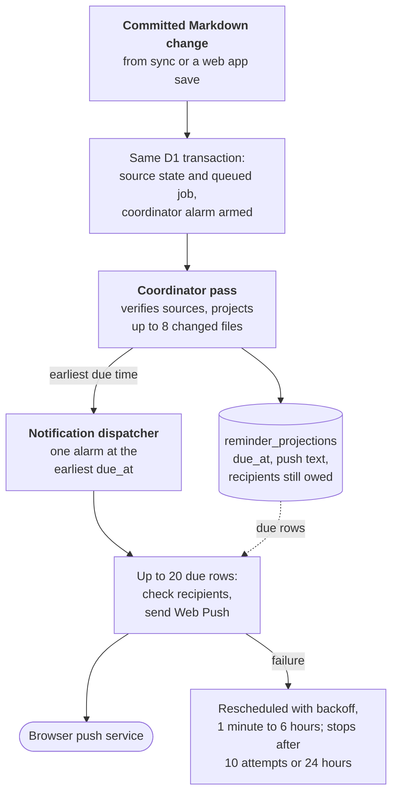

# Notification processing and database reads

Obsidian changes reach the server according to the device's sync settings. Web app changes reach it when their save request succeeds. Each committed Markdown mutation records its source state and affected notification work in the same D1 transaction. Mutations affecting reminder files, notification policy or explicit retries run under the coordinator Durable Object lock. Deletions and restores wake notification processing only when they name a reminder or Reading note, decided from the request's paths and the folders read under the lock. A reminder command wakes it once its receipt check shows a new command, so a replay wakes nothing. Settings, binary uploads, Markdown commits outside the reminder and Reading folders, token, checkpoint and push subscription changes, and coordinated reads do not wake it; plaintext Reading list and item reads wake it only when they ran a Reading index rebuild step, which can queue article extractions. Article extraction queues the next articles itself and never wakes it. Sync checks and reminder-list access initialize migrations once per parser version. Upload transfer, hashing and R2 staging finish outside the lock; each Markdown publication then uses a short coordinated commit. Before a mutation can commit work, it persists an immediate alarm. The alarm cannot process work until the mutation releases that lock; if the request crashes after committing, the alarm still exists. There is no post-save wake-up gap or recurring notification cron. Coordinated commits are serialized per vault. Most reads stay outside this lock; the plaintext Reading list and item reads, `GET /encryption/reset` and `PUT /settings` take it so they observe or continue serialized state.

The plugin scans local Markdown only for its own UI; the server derives notification schedules from committed Markdown. One `notification_policy` row holds the shared reminders folder, timezone, all-day time, enabled flag and a revision. Startup only initializes an absent policy; an explicit settings edit updates it only while the revision it captured still matches.

A pass first reads its settings and the heads of its queues in one statement and stops there when nothing is pending. Otherwise the coordinator processes a bounded slice of changed files (at most eight per pass), skipping source verification and the Reading steps when that read found nothing for them. Only a reminder with a schedule gets a `reminder_projections` row; a row whose reminder loses its date stays, with its schedule cleared. Each projection commit writes a reminder's schedule into its row: the occurrence (`due_datetime`), push text, next attempt time (`due_at`, indexed only while set), attempts, recipients still owed (`pending_subscriptions`) and the last delivered occurrence (`delivered_due`). The same occurrence keeps its progress when its text changes; a new occurrence starts fresh unless it is the one already delivered. After a pass that wrote a schedule, the coordinator releases its lock and sends one request to the notification dispatcher with the earliest due time. A coordinator flag keeps that request pending across retries until the dispatcher accepts it.

The dispatcher role keeps a single alarm at the earliest `due_at`. Each pass reads the feature policy, up to 20 due rows, their source authority in one query and the push recipients, sends each push, then writes every outcome and reads the next due time in one batch: at most 28 D1 queries with 20 subscriptions. A past next due time chains another pass at once. Each outcome is written only after its push and checks that the occurrence and attempt time are unchanged, so delivery is at least once: a lost write resends the same tag (`reminderId:dueDatetime`), which replaces the shown notification without alerting again. A delivered occurrence is recorded even when the reminder changed meanwhile. A reminder that leaves its note keeps a detached row (no file) with its delivered occurrence, so moving it to another note cannot notify twice; departures remove detached rows older than the 24-hour delivery window. Retries back off from one minute to six hours; ten attempts, the 24-hour window or an oversized payload record `delivery_failed_at` and stop. A pass that fails as a whole retries with the same backoff, at most every six hours, until one succeeds: outstanding schedules have no other wake. While Reminders is paused the dispatcher sends nothing and keeps no alarm; resuming wakes it for the earliest schedule. An encryption reset clears every `due_at` in its first transaction.

Ready file jobs and retry deadlines have separate indexes. A shared per-file retry record covers both source verification and projection, so those stages cannot reset each other’s budget. Selection reads at most the requested number from each index; the next wake uses index heads instead of counting the queue. Temporary file failures retry after an hour; invalid encoding, malformed reminder metadata, oversized source files and conflicting reminder identities pause immediately until edited or explicitly retried. Deliveries retain their exponential retry schedule. A new mutation brings a later coordinator alarm forward. An empty coordinator does not reschedule itself. Processing episodes stop after 24 hours, 10,000 passes, or eight coordinator failures. Pending jobs are retained, and a relevant mutation starts a new episode. Durable Object storage keeps an episode's start and failures; passes are counted in memory, so a pass writes no storage unless it fails or wrote a schedule, and an arm within an hour of a stored episode that has not failed keeps that episode's start. Each role instance finds its alarm duty from its object name; the role flag each stores once per activation covers a runtime that withholds the name. Separately, transient file failures pause after eight failures; unrelated mutations cannot reset that limit. A relevant file edit or an explicit retry can restart paused work. Individual reminder delivery already has an attempt/age limit; waiting for source authority now uses that same limit.

A full Markdown source scan runs once per parser version, with a durable cursor and completion marker. Subsequent invocations only process outdated or failed source records, found through the parser-version index and the retry queue, so a pass with nothing to do reads a few rows however many reminder notes exist. Current file writes record source state atomically, so they do not require another full scan. Source records whose files are gone, such as notes pruned from an initial import, are removed in bounded slices, including after scan completion.

A projection commit is conditional: it applies only while the note's projection job token, the policy revision and the file revision the pass read still match. Projection writes only the reminder rows whose schedule token or note changed, and removes rows only for reminders that left the note, keeping a detached row for a delivered occurrence. Each note's `reminder_source_state.projection_snapshot` records, in the same transaction as the rows it describes, every reminder the last projection saw: its due key, the first observation of that due key and its row's schedule key. A pass compares the parsed note with it in memory, reads source and projection rows only for reminders whose due key or schedule changed, and checks identity conflicts only for reminders new to the note. A commit that adds or removes a reminder identity queues the other notes that hold it with `recheck`, which makes their projection ignore the snapshot and check every identity, so a duplicate still quarantines both notes. Projection rows carry no policy revision: a policy change queues a projection job for every note in the folder and every projected note in the same transaction, and a pending job already withholds delivery authority. A commit that keeps every reminder's ID, due key and count leaves the note's source rows alone, and one that keeps every ID looks up no other owners: `reminder_source_state.sources_digest` records digests of the last verified IDs and summary, and the statements' note key is NULL when they match, so they read no rows. Delivery authority requires the note's current revision to be verified with the current parser and no projection job to be pending for the note. Every commit that records a verified revision queues that note's job in the same transaction, and a projection removes the job only together with its writes. A pass reuses the bytes a commit in the same object just published, checked against the committed hash, instead of reading them back from R2. Editing one reminder writes about the same rows in a 20- or a 400-reminder note.

When D1's daily allowance is exhausted, the coordinator and the dispatcher wait for the 00:00 UTC reset, with up to ten minutes of jitter. That wait does not count against the coordinator's failure budget or a delivery's attempts. A delivery resumed after its 24-hour window records the failure once D1 accepts writes again.

## Push recipients and delivery

Each push subscription records the session that created it as its owner, and maintenance removes subscriptions whose owner is gone. Recipient selection checks authority at delivery, independently of maintenance (`notifications/recipient-authority.ts`): the subscription is not disabled, no encryption reset is in progress, and its owner token is unexpired and either a vault token or a reminders token for the current notification folder. Web app logout captures its revocation request before clearing local state.

Delivery accepts only endpoints of known browser push services (`notifications/push-endpoint.ts`), rejects redirects and has a ten-second network deadline. A 404 or 410 response deletes the subscription; 408, 425, 429 and 5xx responses and network errors are retried with the delivery; any other failure quarantines the subscription (`disabled_at`). An exhausted delivery keeps its `delivery_failed_at` record, which server diagnostics count; a new occurrence clears it and starts a new attempt.

A self-hosted server's host process can also push an alert (`notifications/host-alerts.ts`): an automatic backup failed, the public address stayed unreachable, or the disk is nearly full. It calls the dispatcher role's `/host-alert` path through the local Durable Object namespace, never a public route, and the same recipients receive it unless reminders are paused. Alert text is fixed and plaintext, since the host has no notification key, so it names no paths or vault data. The host sends each kind at most once a day.

When a browser replaces a subscription, the PWA service worker renews it with the same server key and asks open pages to register the new endpoint. It holds no credential, so a closed app registers the endpoint at its next launch.

## Regression measurement

`notifications/quota.integration.ts` measures `meta.rows_read` in the local Cloudflare D1 runtime with 2,000 and 10,000 queued files. At 2,000 files, the old job-selection and queue-count queries read 8,001 rows per pass; their replacements read 6. Both queue sizes must remain at or below 10 reads per pass, including queues containing only failures that are not due yet.

`reminders/write-cost.integration.ts` meters each request together with the alarms it arms. One reminder edit writes 14 rows in a 20- and in a 400-reminder note (123 and 2,023 before the first rework, 23 before the source digest, 15 before the projection snapshot) and reads 110 rows in both (743 and 12,528 before the first rework, 441 and 6,524 before the snapshot). Its request makes 5 D1 round trips (11 before), its receipt replay arms no pass, and a pass with nothing to do makes one query that reads 20 rows with 2,002 reminder notes (6,029 rows before the first rework, 9 queries and 24 rows before the early exit).

`notifications/dispatcher-budget.integration.ts` meters delivery on top of projection. Editing one reminder's due time, with its alarms, costs 13 queries, 21 written rows, 3 Durable Object requests and 1 alarm; with one Durable Object per reminder and a D1 outbox it cost 36, 23, 4 and 2, and 21 queries and 20 rows before the early exit and the projection snapshot, which adds one written row. The dispatcher's share is one request with no D1 query. Delivering 20 due reminders takes one pass of 6 queries and 20 written rows, where each delivery used to take 7 queries in its own alarm.

For 1,200 equivalent passes, 6 reads per pass projects to 7,200 reads for these two operations. This is not a total notification-processing estimate: file parsing, source verification, delivery, sync, and maintenance have their own reads. Production analytics should be checked after deployment.

Tests also cover eight-attempt limits, unrelated edits leaving paused work unchanged, manual retries, bounded reads with 10,000 paused files, and idle runs without file scans or database writes, exact retry deadlines, prompt wakeups for new work, parser-version revalidation, and changes after revalidation.

## Housekeeping without idle polling

An authenticated mutation arms a separate cleanup Durable Object for one run 24 hours later. Additional activity does not postpone an already scheduled run. Cleanup wakes notification processing at most once per episode, and only while Reading article fetching is on, to recover Reading work. If queued object cleanup advances and more remains, it schedules another pass five seconds later, up to ten passes total. A stalled backlog stops. Cloudflare can retry a thrown alarm failure a bounded number of times. An idle server therefore has no ongoing maintenance timer once that bounded episode finishes. Expired history or orphaned objects may remain until activity triggers another cleanup; expiry checks on authentication and access still apply.

Reminder schedules set by the user keep the dispatcher's alarm until delivery, cancellation, or their finite failure limit.

Paused updates appear in Run diagnostics. The notification retry API requeues up to 100 files per explicit action and reports whether more remain. It does not resend completed deliveries; missed reminders still need to be rescheduled.

## Unfinished uploads

Every managed upload records a publication lease in D1 before writing R2. Publication checks that the lease is pending and unexpired, then removes the record in the same transaction that makes the file live. Lease creation and publication checks use the database clock.

Cleanup claims at most ten expired uploads per pass after 24 hours, checks live files and retained versions, and deletes only unreferenced objects. A claimed upload cannot subsequently publish. Missing objects retain their record because an in-flight upload may finish later. Unconfirmed cleanup retries at most eight times, then pauses with a diagnostic entry. Future expiry deadlines can schedule another alarm within the ten-pass maintenance episode; no permanent polling timer is introduced.

Uploads use indexed records rather than bucket-wide scans.
